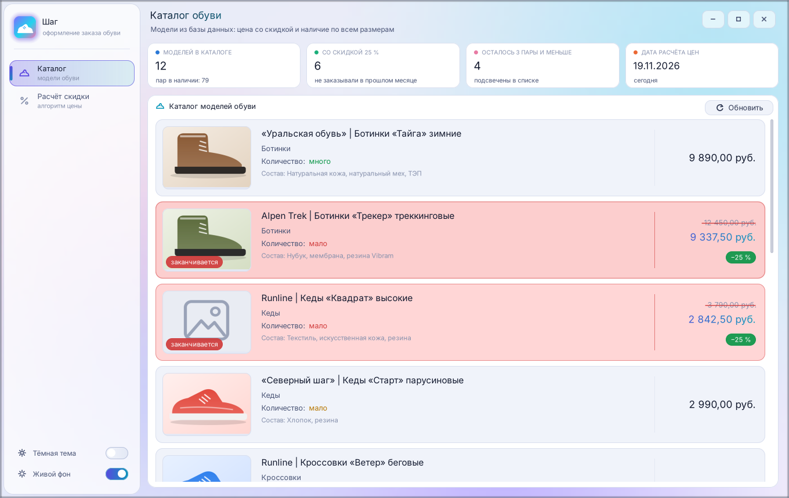
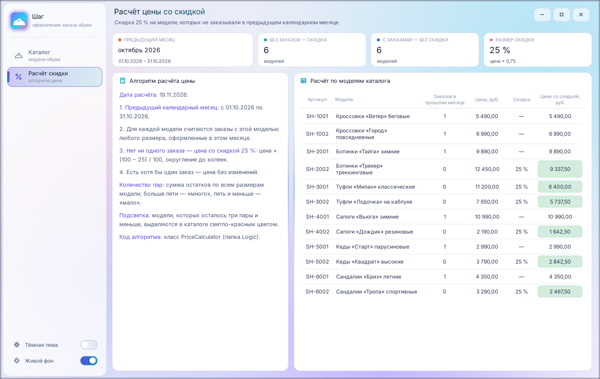
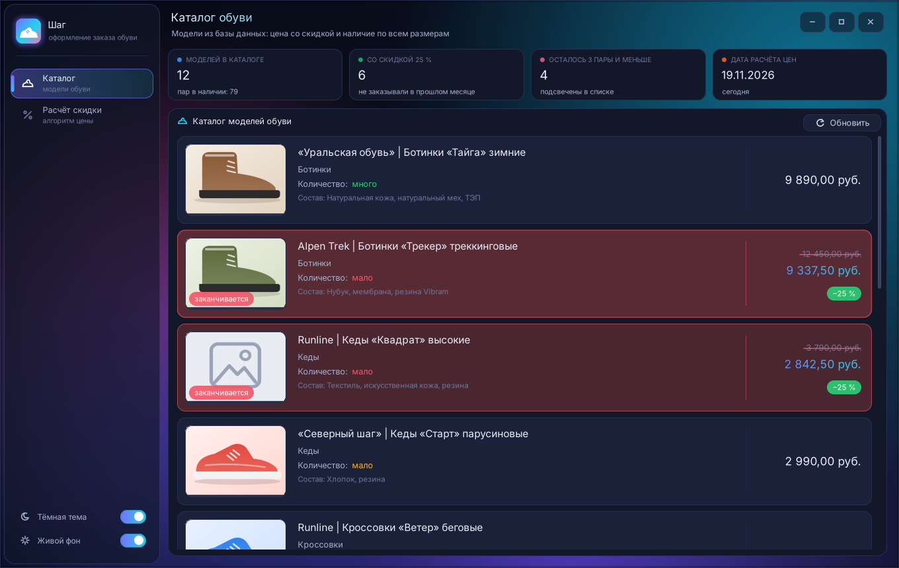
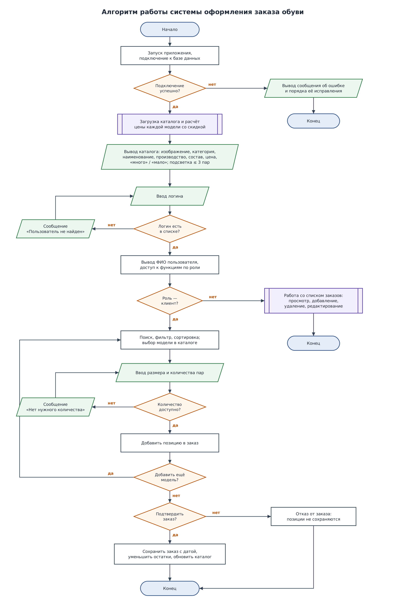
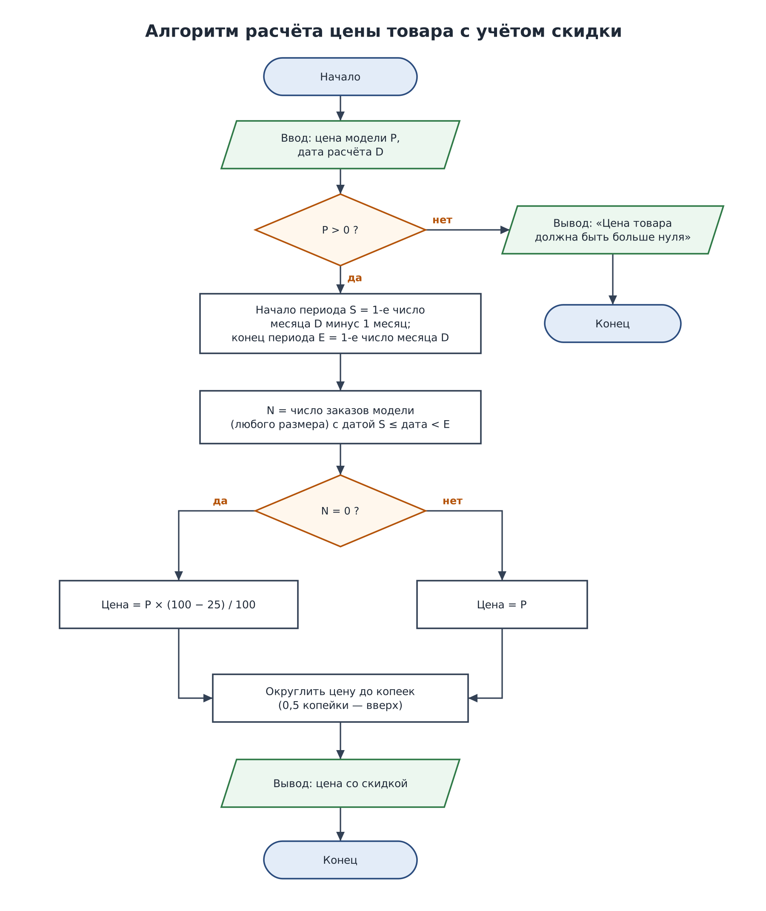

# «Шаг» — система оформления заказа обуви

Демонстрационный экзамен, КИМ 09.02.07-2-2027, **задание 2 «Разработка алгоритма и создание приложения»**.
Компания-заказчик — «Шаг», продажа обуви. Приложение показывает каталог моделей обуви из базы данных
и считает цену каждой модели с учётом скидки.

**Платформа:** C#, Windows Forms, .NET Framework 4.7.2, MS SQL Server. Сторонних библиотек нет.
Оформление — собственная библиотека FxKit (как в проекте Forecast): окно без системной рамки,
боковая панель, заставка при запуске, светлая и тёмная темы, плавные анимации.



## Функциональность

**Каталог моделей обуви** (главная форма) — по предоставленному макету, для каждой модели:

- изображение модели; если изображения нет — картинка-заглушка `picture.png` из ресурсов;
- «Производство | Наименование», категория, состав;
- количество пар суммарно по всем размерам: **«много»**, если пар больше пяти, **«мало»**, если пять и меньше;
- цена в рублях с учётом скидки; при скидке старая цена зачёркнута, рядом метка «−25 %»;
- модели, которых осталось **три пары и меньше**, подсвечены **светло-красным** (и помечены «заканчивается»).

Над списком — сводка: число моделей, сколько из них со скидкой, сколько подсвечено, дата расчёта.
Кнопка «Обновить» перечитывает каталог из базы. Фильтрация, сортировка и поиск на этом этапе
по заданию не требуются (они — в задании 3).

**Расчёт цены со скидкой** — скидка 25 % на модели, по которым нет заказов в предыдущем календарном месяце
относительно даты расчёта. На отдельной странице показан алгоритм, период предыдущего месяца и расчёт по каждой модели.





## Алгоритмы

Блок-схемы по ГОСТ 19.701-90 — папка `algorithms` (редактируемые `.drawio`, а также PNG и PDF).

| Алгоритм работы системы | Алгоритм расчёта цены со скидкой |
|---|---|
|  |  |

Алгоритм расчёта цены реализован в классе `Logic/PriceCalculator.cs`:

1. Предыдущий календарный месяц — с 1-го числа прошлого месяца (включительно) до 1-го числа месяца даты расчёта (не включительно).
2. Для модели считаются заказы с любым её размером, оформленные в этом периоде (`Data/ProductRepository.cs`, параметры `@PrevStart`, `@PrevEnd`).
3. Заказов нет — цена × (100 − 25) / 100, округление до копеек (половина копейки — вверх). Заказы есть — цена без изменений.

## Соответствие требованиям задания 2

| Требование | Как выполнено |
|---|---|
| Наименование приложения включает название компании | заголовок окна «Шаг — каталог обуви», название в боковой панели и на заставке |
| Единый внешний вид, цвета, шрифты | одна тема FxKit для всех элементов; шрифты Manrope и Unbounded в папке `Fonts` |
| Логотип из ресурсов | `Resources/logo.png` — в боковой панели и на заставке |
| Иконка приложения из ресурсов | `Resources/icon.ico` — иконка exe (`ApplicationIcon`) и окна |
| Заголовок окна соответствует назначению | меняется вместе с разделом: «Шаг — Каталог обуви», «Шаг — Расчёт цены со скидкой» |
| Оформление кода | CamelCase, одна команда в строке, комментарии только к неочевидным местам |
| Каталог по макету | `Controls/ProductList.cs` |
| Заглушка при отсутствии изображения | `Resources/picture.png`; используется и если файл изображения не найден |
| «много» / «мало» | `PriceCalculator.GetQuantityText`: больше 5 пар — «много» |
| Подсветка ≤ 3 пар светло-красным | `PriceCalculator.IsLowStock`, цвет `#FFD6D6` |
| Цена со скидкой 25 % | `PriceCalculator.GetPrice` |
| Отладка, без аварийного завершения | тесты `ShagShoes.Tests` (18 проверок); все ошибки перехватываются, при недоступной базе — сообщение с порядком действий |

## Как запустить

1. Создать базу: открыть `db/ShagShoes.sql` в SQL Server Management Studio и выполнить (F5).
   Скрипт создаёт базу `ShagShoes` (8 таблиц, 3НФ, внешние ключи) и тестовые данные.
   Даты заказов задаются относительно дня запуска скрипта, поэтому скидка всегда видна на примерах.
2. Открыть `src/ShagShoes.sln` в Visual Studio 2019 или новее и нажать F5.
   По умолчанию программа подключается к `(localdb)\MSSQLLocalDB`. Для другого сервера
   измените строку подключения `ShagShoes` в `App.config` (после сборки — `ShagShoes.exe.config`).

Готовая программа (без Visual Studio) — архив `ShagShoes_exe.zip` в релизе: распаковать и запустить `ShagShoes.exe`.
Папки `Fonts`, `Images` и `Resources` должны лежать рядом с exe.

Параметры запуска (необязательные): `--dark` — тёмная тема; `--page=1` — сразу раздел «Расчёт скидки»;
`--date=2026-12-05` — рассчитать цены на другую дату (удобно проверить скидку); `--instant` — без анимаций.

## Проверка

- `ShagShoes.Tests.exe` — 18 проверок модуля цены: скидка и её отсутствие, округление, ошибочные цены,
  границы месяца (первое и последнее число, январь → декабрь, февраль високосного года), «много» / «мало», подсветка.
  Код возврата 0 — все проверки пройдены.
- Скрипт базы выполнен на SQL Server 2022; в конце он выводит каталог так, как его показывает программа.
- Программа запущена с этой базой; снимки экрана выше сняты с работающего приложения.

## Структура

```
db/ShagShoes.sql            скрипт базы данных с тестовыми данными
algorithms/                 блок-схемы алгоритмов (.drawio, .png, .pdf)
src/ShagShoes.sln           решение Visual Studio
src/ShagShoes/
  Logic/PriceCalculator.cs  алгоритм цены со скидкой, «много» / «мало», подсветка
  Data/                     подключение к базе и чтение каталога (параметризованный запрос)
  Models/Product.cs         модель обуви
  Controls/ProductList.cs   каталог по макету
  MainForm.cs               главное окно
  Fx/                       библиотека оформления FxKit
  Resources/                logo.png, icon.ico, picture.png
  Images/                   изображения моделей
  Fonts/                    шрифты (лицензия OFL)
src/ShagShoes.Tests/        проверки модуля цены
tools/                      скрипты, которыми сделаны изображения и блок-схемы
```

## Что учесть

Приложения 1–3 к заданию (описание предметной области, файлы для импорта, руководство по стилю) в выданном
PDF не вложены. Поэтому название компании, цвета, логотип и тестовые данные подобраны самостоятельно.
Если руководство по стилю выдадут, меняются только цвета темы (`Fx/Theme.cs`), шрифты и файлы в `Resources`.
