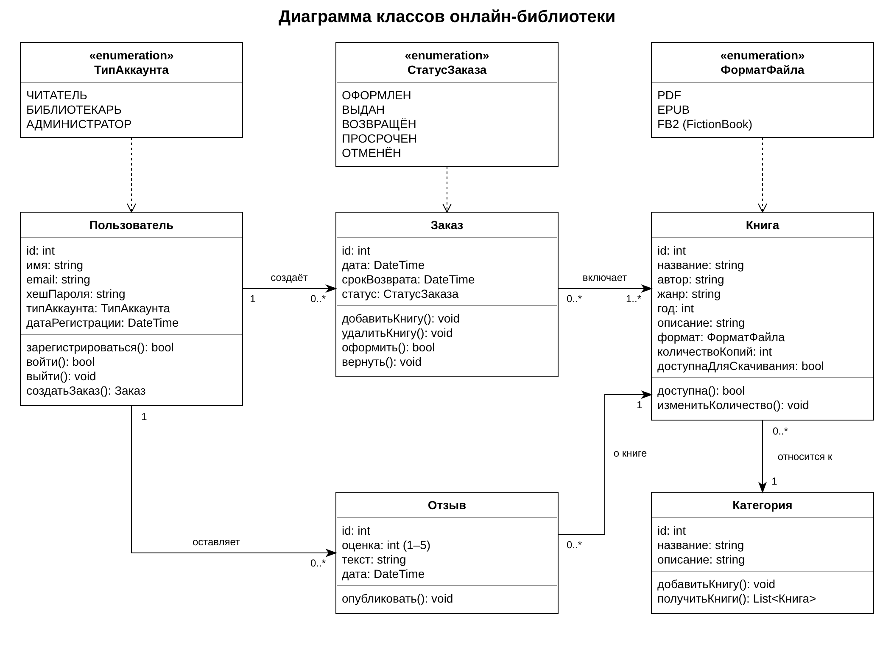
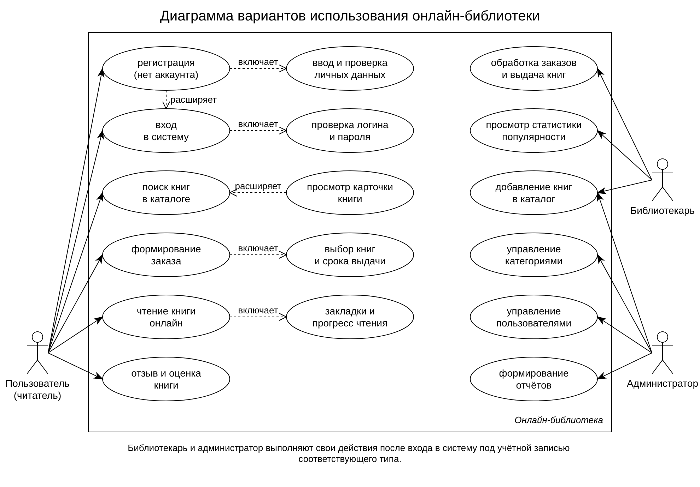
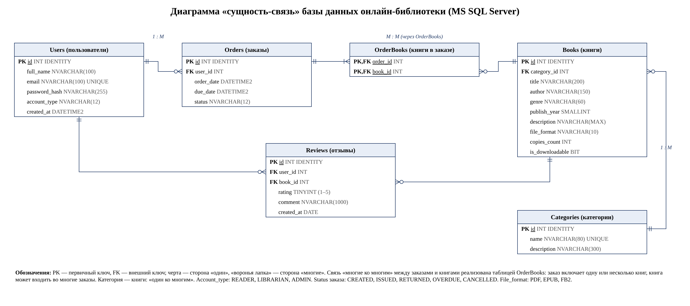

# День 4 — диаграммы онлайн-библиотеки

Задание: по описанию предметной области «онлайн-библиотека» построить три диаграммы,
показывающие структуру и работу системы.

| Диаграмма | Исходник draw.io | Картинка |
|---|---|---|
| Диаграмма классов | [`Диаграмма_классов.drawio`](Диаграмма_классов.drawio) | [`PNG`](Диаграмма_классов.png) |
| Диаграмма вариантов использования | [`Диаграмма_вариантов_использования.drawio`](Диаграмма_вариантов_использования.drawio) | [`PNG`](Диаграмма_вариантов_использования.png) |
| Диаграмма «сущность-связь» | [`Диаграмма_сущность-связь.drawio`](Диаграмма_сущность-связь.drawio) | [`PNG`](Диаграмма_сущность-связь.png) |

Файлы `.drawio` открываются в [app.diagrams.net](https://app.diagrams.net) или в настольном draw.io.

## Диаграмма классов

- **Книга** — название, автор, жанр, год, а также описание, формат файла, количество копий и признак скачивания.
- **Пользователь** — имя, email, тип аккаунта (читатель, библиотекарь, администратор).
- **Категория** — название и описание.
- **Заказ** — дата, срок возврата, статус.
- **Отзыв** — оценка и текст, которые читатель оставляет о книге.

Связи: пользователь создаёт заказы (1 → 0..\*), заказ включает одну или несколько книг (0..\* → 1..\*),
книга относится к категории (0..\* → 1), пользователь оставляет отзывы о книгах.

## Диаграмма вариантов использования

- **Пользователь (читатель)**: регистрируется и входит в систему, ищет книги, формирует заказ, читает онлайн, оставляет отзыв.
- **Библиотекарь**: обрабатывает заказы и выдаёт книги, смотрит статистику популярности, пополняет каталог.
- **Администратор**: добавляет книги, управляет категориями и пользователями, формирует отчёты.

## Диаграмма «сущность-связь»

Таблицы: `Users`, `Orders`, `Books`, `Categories`, `Reviews` и связующая `OrderBooks`.

- заказы — книги: **многие ко многим** через `OrderBooks`;
- категории — книги: **один ко многим** (`Books.category_id`);
- пользователи — заказы: **один ко многим** (`Orders.user_id`).
