# Дни 5–6. Приложение «Киноточка» с базой данных

**День 5.** Разработка приложения и подключение базы данных.
**День 6.** Реализация функций, тестирование и итоги.

**Предметная область:** кинотеатр «Киноточка», продажа билетов (продолжение дней [1](../UML_Den1)–[4](../UML_Den4)).
**Платформа:** C#, Windows Forms, .NET Framework 4.7.2, Microsoft SQL Server. Сторонних библиотек нет.
**База данных:** «Киноточка» из дня 4 — 14 таблиц с русскими названиями (скрипты продублированы в папке `db`).

Отчёт — [`Отчёт_День5-6.pdf`](Отчёт_День5-6.pdf). Как запустить на защите — [`ЗАЩИТА.md`](ЗАЩИТА.md).

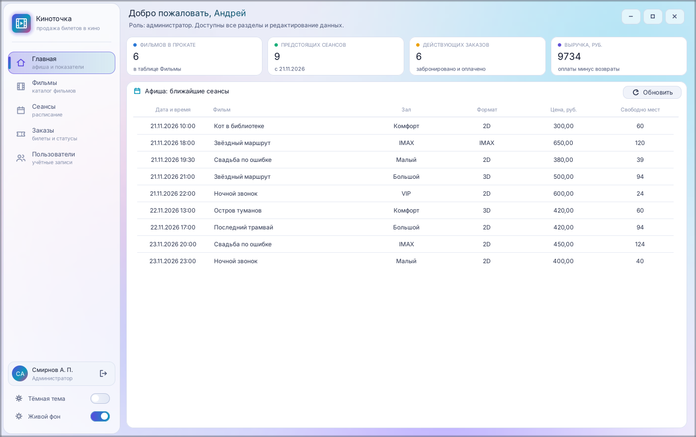

## Как запустить

1. **База.** В SQL Server Management Studio выполнить по очереди `db/01_create.sql` и `db/02_data.sql` (F5).
   Или из командной строки:
   ```
   sqlcmd -S "(localdb)\MSSQLLocalDB" -f 65001 -i db\01_create.sql
   sqlcmd -S "(localdb)\MSSQLLocalDB" -f 65001 -i db\02_data.sql
   ```
2. **Программа.** Открыть `src/Kinotochka.sln` в Visual Studio 2019 или новее и нажать F5
   (или запустить готовый `Kinotochka.exe` из архива `Kinotochka_exe.zip` на странице релиза).
3. По умолчанию программа подключается к `(localdb)\MSSQLLocalDB`. Другой сервер (например `.\SQLEXPRESS`)
   указывается прямо в программе: форма входа → **«Подключение»** → «Проверить» → «Сохранить».

| Учётная запись | Пароль | Роль | Что доступно |
|---|---|---|---|
| admin@kinotochka.ru | 123456 | Администратор | все разделы, добавление, изменение, удаление, пользователи |
| cashier1@kinotochka.ru | 123456 | Кассир | фильмы и сеансы (просмотр), все заказы, смена статуса |
| ivanov@example.com | 123456 | Зритель | афиша, фильмы, сеансы, только свои заказы |
| morozov@example.com | 123456 | Зритель (заблокирован) | вход запрещён — для проверки |

Новая учётная запись зрителя создаётся кнопкой «Регистрация» на форме входа.

## День 5

| Задание | Как выполнено |
|---|---|
| 1. Создание проекта | решение `src/Kinotochka.sln`; интерфейс (`Forms`), бизнес-логика (`Logic`), работа с данными (`Data`), классы записей (`Models`); проект проверок `Kinotochka.Tests` |
| 2. Подключение базы данных | класс `Data/Db.cs`: строка подключения из `Kinotochka.exe.config`, соединение открывается и закрывается в блоке `using`, все значения — параметры `SqlParameter` |
| 3. Создание интерфейса | 8 форм (нужно не менее 4) — таблица ниже |
| 4. Навигация и отображение | боковая панель разделов, переходы к формам редактирования, подписи полей, кнопки действий, таблицы записей с заголовками на русском; при недоступной базе — сообщение и кнопка «Подключение» |

| № | Форма | Класс | Назначение |
|---|---|---|---|
| 1 | Вход в систему | `LoginForm` | авторизация, проверка подключения к базе |
| 2 | Регистрация | `RegisterForm` | новая учётная запись зрителя |
| 3 | Подключение к базе данных | `ConnectionForm` | выбор сервера SQL Server, проверка связи |
| 4 | Главное окно | `MainForm` | разделы Главная, Фильмы, Сеансы, Заказы, Пользователи |
| 5 | Фильм | `FilmEditForm` | добавление и изменение фильма |
| 6 | Сеанс | `ScreeningEditForm` | добавление и изменение сеанса |
| 7 | Пользователь | `UserEditForm` | управление пользователями (администратор) |
| 8 | Статус заказа | `OrderStatusForm` | смена статуса заказа (кассир, администратор) |

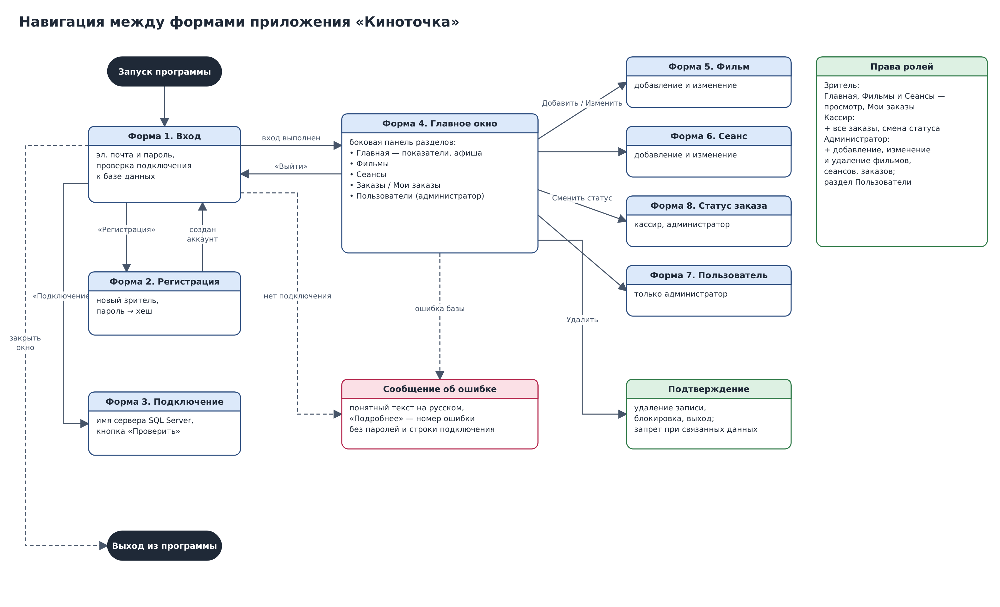

## День 6

| Задание | Как выполнено |
|---|---|
| 1. Авторизация и регистрация | пароль хранится только как хеш PBKDF2-SHA256 (100 000 итераций, своя соль); проверка обязательных полей и формата; одинаковое сообщение для неверной почты и пароля; после 3 ошибок вход приостанавливается на 30 с; заблокированный пользователь не входит |
| 2. Операции с данными | Фильмы, Сеансы, Пользователи — добавление, просмотр с поиском, изменение, удаление; Заказы — просмотр, поиск, смена статуса, удаление. Перед удалением — проверка связанных записей и подтверждение |
| 3. Обработка исключений | ошибки подключения, ввода, ограничений (UNIQUE, FOREIGN KEY, CHECK, триггер) переводятся в понятные сообщения; технические детали — по кнопке «Подробнее» и в журнале `%LOCALAPPDATA%\Kinotochka\errors.log` без паролей |
| 4. Тестирование | `Kinotochka.Tests.exe` — 58 проверок, все пройдены; таблица — [`tests/Результаты_тестирования.md`](tests/Результаты_тестирования.md) (и `.csv` для Excel) |
| 5. Отчёт | [`Отчёт_День5-6.pdf`](Отчёт_День5-6.pdf): диаграммы, описание базы, снимки форм, SQL-запросы, результаты тестирования, итоги |

### Операции с данными и целостность

| Таблица | Добавление | Изменение | Удаление |
|---|---|---|---|
| Фильмы | да | да | запрещено, если есть сеансы или отзывы — программа предлагает снять фильм с проката |
| Сеансы | да, зал не должен быть занят | да | запрещено, если есть заказы |
| Пользователи | да | да, блокировка | запрещено, если есть заказы или отзывы, и для своей учётной записи |
| Заказы | — | смена статуса | запрещено при платежах; иначе вместе с билетами (каскадное удаление) |

### Результаты тестирования (кратко)

| Раздел | Проверок | Пройдено |
|---|---|---|
| Хеширование паролей | 5 | 5 |
| Проверка ввода (пустые поля, неверные значения) | 15 | 15 |
| Обработка исключений | 1 | 1 |
| Подключение (открытие, чтение, закрытие) | 1 | 1 |
| Авторизация (успешная и неуспешная) | 7 | 7 |
| Регистрация | 4 | 4 |
| Фильмы (добавление, поиск, изменение, права, SQL-инъекция) | 8 | 8 |
| Сеансы | 4 | 4 |
| Удаление и целостность | 7 | 7 |
| Заказы и права | 4 | 4 |
| Недоступность базы | 2 | 2 |
| **Итого** | **58** | **58** |

Запуск проверок: `src\Kinotochka.Tests\bin\Release\Kinotochka.Tests.exe` (база должна быть создана; созданные при проверке записи удаляются).

## Снимки экрана

| | |
|---|---|
| 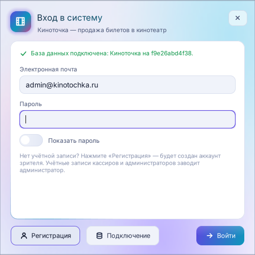 Вход | 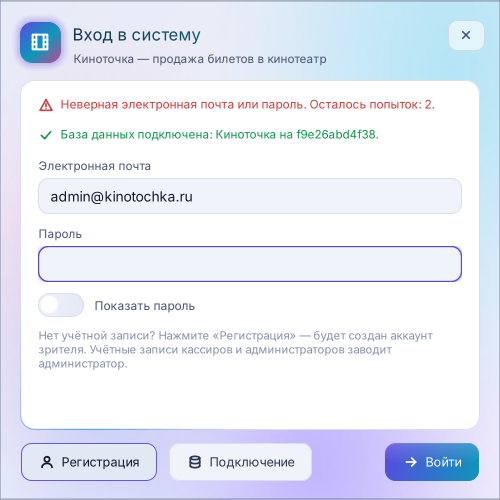 Неверный пароль |
| 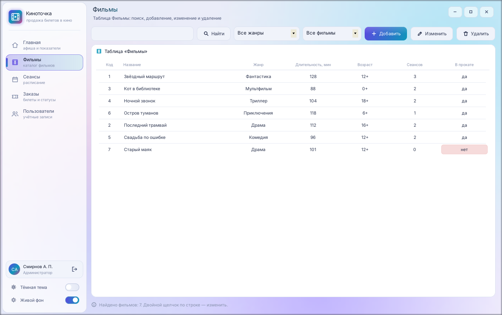 Фильмы | 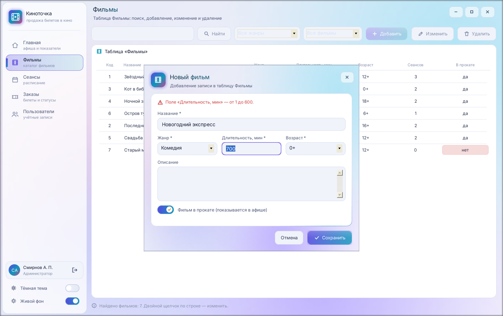 Проверка ввода |
| 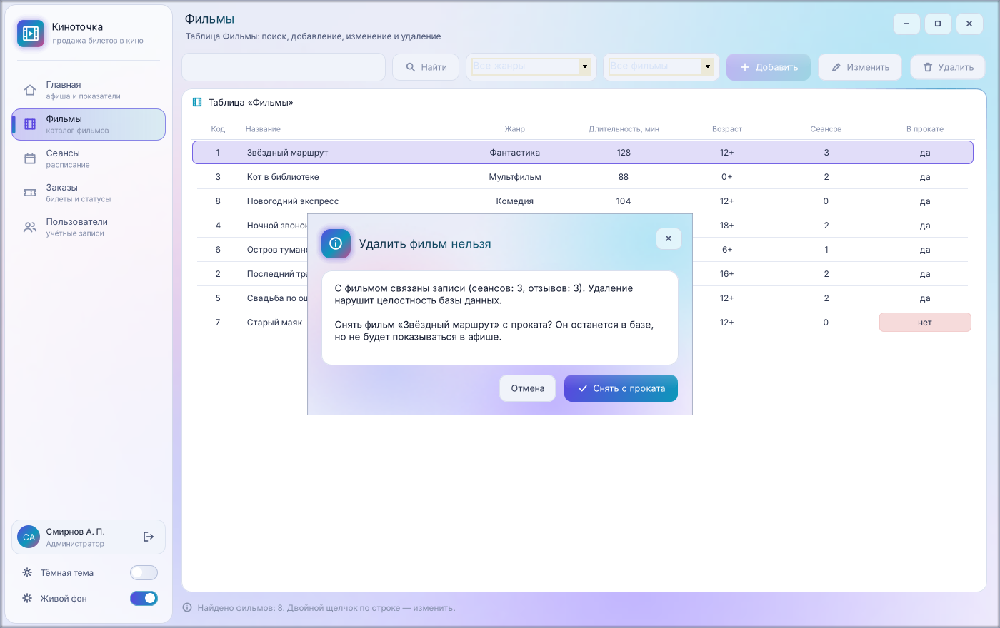 Удаление запрещено | 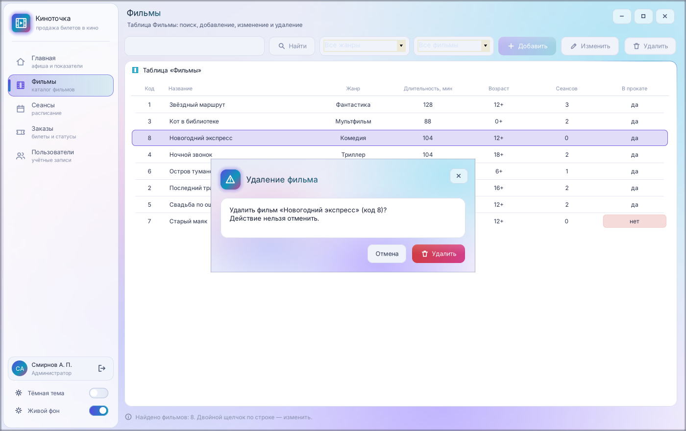 Подтверждение удаления |
| 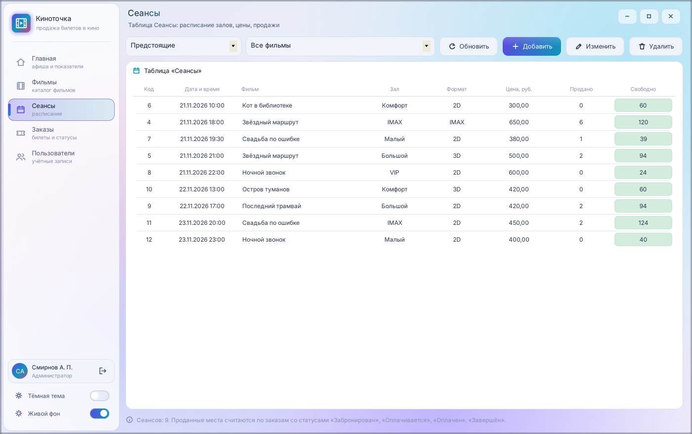 Сеансы | 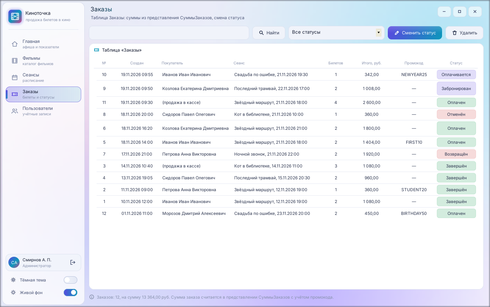 Заказы |
| 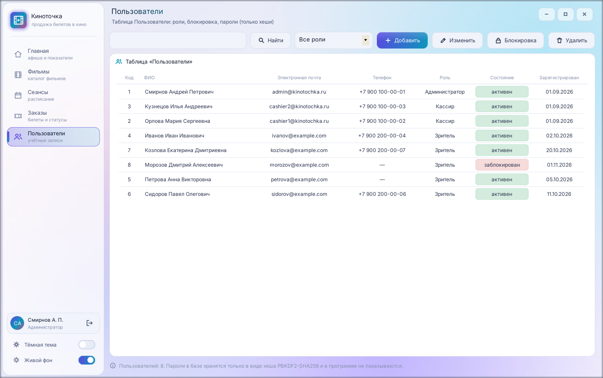 Пользователи | 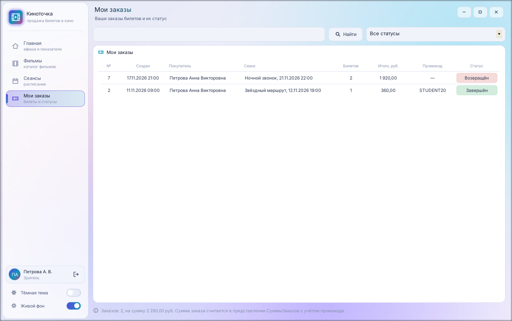 Зритель: мои заказы |
| 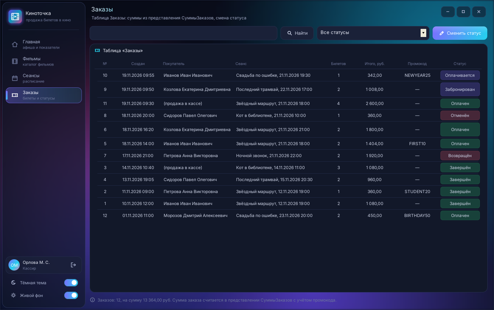 Кассир, тёмная тема | 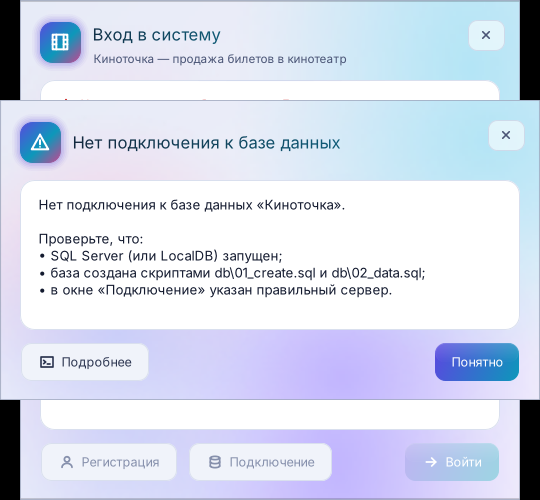 Нет подключения |

## Структура

```
db/01_create.sql, 02_data.sql   база «Киноточка» (день 4)
db/03_app_queries.sql           запросы приложения (выполняются в SSMS, данные не меняют)
src/Kinotochka.sln              решение Visual Studio
src/Kinotochka/Forms            формы
src/Kinotochka/Logic            бизнес-логика: вход, регистрация, проверки, права, хеш паролей, исключения
src/Kinotochka/Data             подключение к базе и запросы
src/Kinotochka/Models           классы записей
src/Kinotochka/Fx               библиотека оформления FxKit
src/Kinotochka.Tests            автоматические проверки
diagrams/                       структура решения, навигация, алгоритм входа (.drawio, .png, .svg)
docs/                           снимки экрана
tests/                          результаты тестирования (.md, .csv)
tools/                          генераторы диаграмм и отчёта
```
