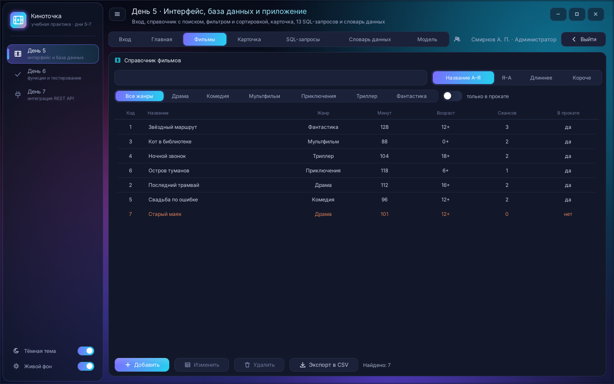

# Дни 5–7 учебной практики — кинотеатр «Киноточка»

Одна программа `Den5_7.exe` (C#, WinForms, .NET Framework 4.7.2, оформление FxKit как у Forecast): слева в панели — **день 5, день 6, день 7** по порядку, разделы дня — вкладки сверху, кнопка **«☰»** (три параллельные полоски) сворачивает панель. База — MS SQL Server `Киноточка` (16 таблиц, русские названия).

| День | Что сделано | Документ |
|---|---|---|
| 5 | IDEF0 A0 (5 подпроцессов, ICOM), карта экранов, макеты, сообщения; ER-диаграмма (16 таблиц, связи 1:1, 1:N, N:M); 1НФ–3НФ; ограничения NOT NULL / UNIQUE / CHECK / DEFAULT / FK; 13 SQL-запросов, 3 представления, 2 параметризованных запроса; приложение: вход, справочник с поиском, фильтром и сортировкой, карточка, словарь данных | [День5_проектирование_и_БД.md](docs/День5_проектирование_и_БД.md) |
| 6 | Отчёты о выручке и заполняемости, экспорт в CSV, журнал действий; 21 тест-кейс (21 из 21); обработка исключений; 9 исправленных ошибок; инструкции пользователя и по развёртыванию; сценарий защиты на 5–7 минут; комплектность | [День6_функции_и_тестирование.md](docs/День6_функции_и_тестирование.md) |
| 7 | Модули «Клиенты» и «Заявки» — отдельные процессы на портах 5101 и 5102, JSON по HTTP; проверка клиента при создании заявки; карточка клиента из двух модулей; контракт OpenAPI; 10 тестов интеграции (10 из 10) | [День7_интеграция_REST.md](docs/День7_интеграция_REST.md) |

Пояснительная записка — [`docs/Пояснительная_записка.pdf`](docs/Пояснительная_записка.pdf).



## Запуск

1. Создать базу (SQL Server 2017+, подходит LocalDB), по порядку:
   ```
   sqlcmd -S "(localdb)\MSSQLLocalDB" -E -b -f 65001 -i ..\UML_Den4\sql\01_create.sql
   sqlcmd -S "(localdb)\MSSQLLocalDB" -E -b -f 65001 -i ..\UML_Den4\sql\02_data.sql
   sqlcmd -S "(localdb)\MSSQLLocalDB" -E -b -f 65001 -i sql\04_den5.sql
   sqlcmd -S "(localdb)\MSSQLLocalDB" -E -b -f 65001 -i sql\05_queries.sql
   ```
2. Запустить `Den5_7.exe` (релиз: `Den5_7_exe.zip`) или открыть `src/Den5_7.sln` в Visual Studio → F5.
3. Вход: `admin@kinotochka.ru` / `123456` (кассир `cashier1@kinotochka.ru`, зритель `ivanov@example.com`).

Строка подключения — `Den5_7.exe.config` (`connectionStrings`, имя «Киноточка»), порты модулей — там же (`ClientsPort`, `RequestsPort`).

Проверки без окна: `Den5_7.exe --run-tests=отчёт.md` (21 тест-кейс дня 6, нужна база), `Den5_7.exe --run-integration=отчёт.md` (10 тестов дня 7, база не нужна).

## Диаграммы

Папка [`docs/diagrams`](docs/diagrams): у каждой диаграммы `.drawio` (редактируется в draw.io), `.png`, `.svg`, `.pdf`.

| Файл | Диаграмма |
|---|---|
| `den5_idef0_a0` | функциональная диаграмма IDEF0 A0 приложения |
| `den5_screen_map` | карта экранов и переходов дней 5–7 |
| `den5_er` | ER-диаграмма базы (16 таблиц) |
| `den6_deployment` | схема развёртывания |
| `den7_integration` | интеграция модулей через REST API |
| `den7_sequence` | последовательность «создание заявки» |

## Папки

```
Den5_7/
  src/          решение Visual Studio Den5_7.sln
  sql/          04_den5.sql (журнал, профили 1:1, роли, представления, описания полей), 05_queries.sql (13 запросов)
  docs/         документы дней 5–7, диаграммы, снимки экранов, словарь данных, результаты запросов,
                тест-кейсы, openapi.yaml, пояснительная записка
  tools/        генераторы: make_sql.py (04_den5.sql), build_er5.py и build_diagrams57.py (диаграммы),
                schema_dump.sql и schema.json (выгрузка структуры базы для ER-диаграммы)
  ПРОМПТ_ДЛЯ_АГЕНТА.md   текст для агента: развернуть и проверить всё на компьютере для защиты
```

Скрипты `01_create.sql` и `02_data.sql` — из дня 4 (`UML_Den4/sql`), в релизе они лежат вместе с 04 и 05 в `Den5_7_sql.zip`.
