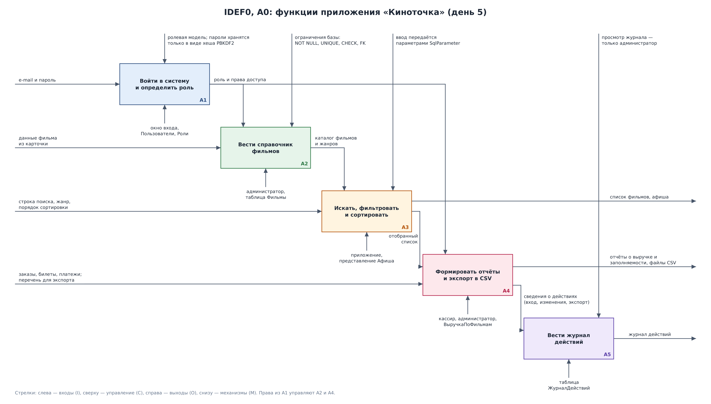
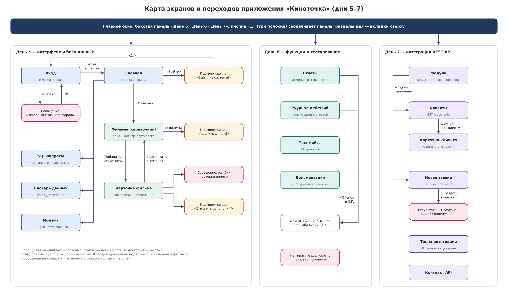
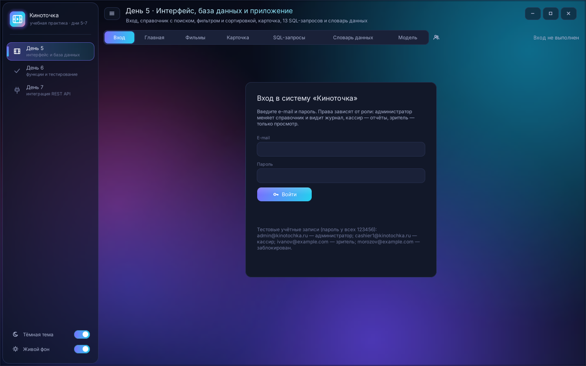
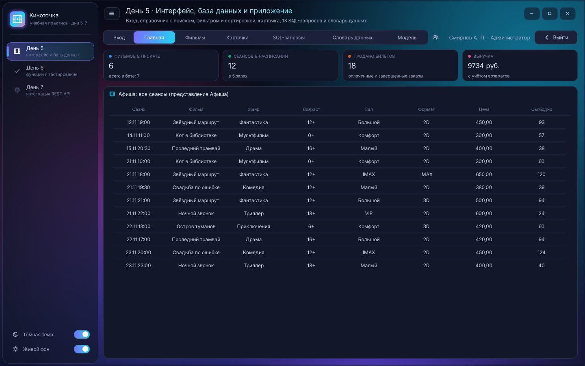
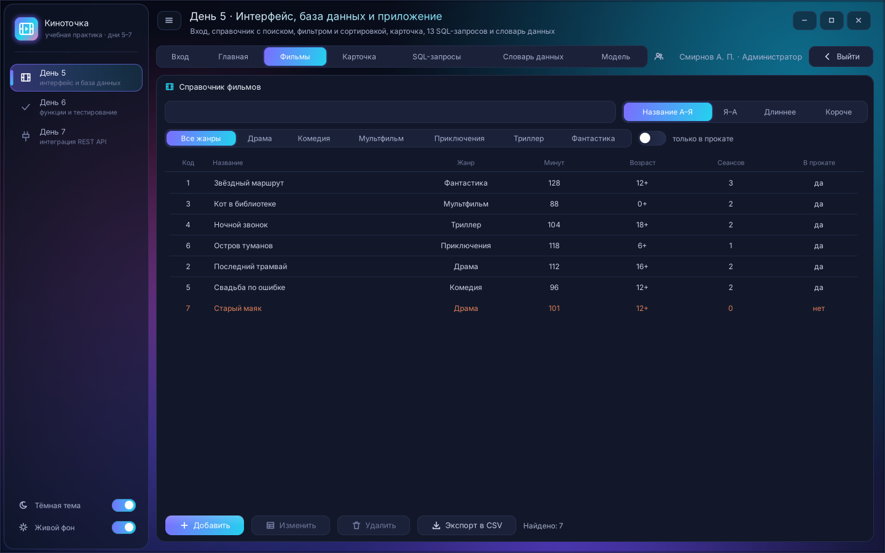
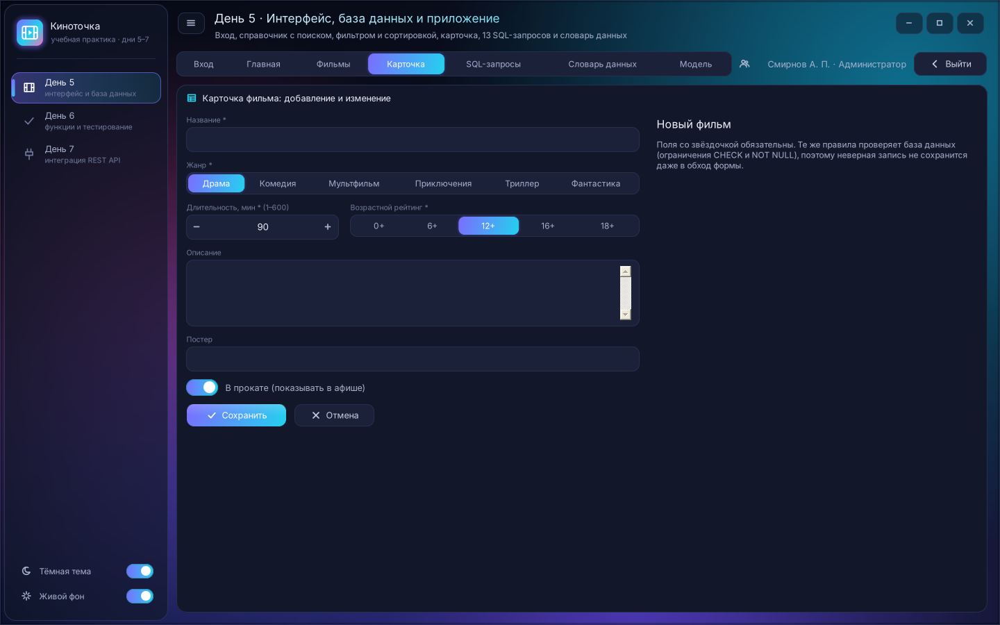
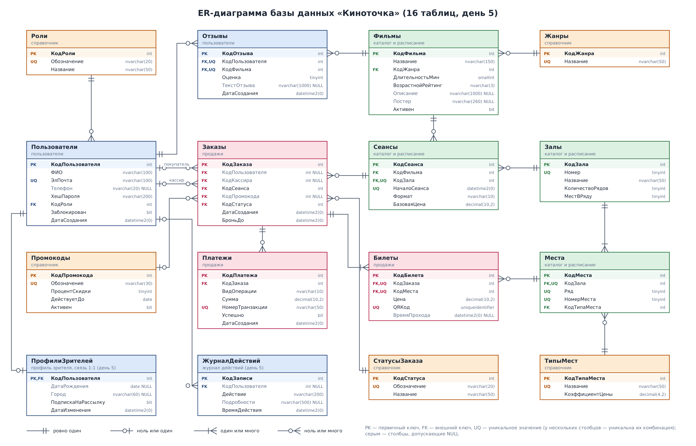

# День 5. Проектирование интерфейса, база данных и приложение

Предметная область — кинотеатр «Киноточка». Приложение — `Den5_7.exe` (C#, WinForms, .NET Framework 4.7.2), база — MS SQL Server `Киноточка`.

## 1. Функциональная диаграмма (IDEF0, A0)



Главная функция — работа кинотеатра «Киноточка» в приложении. Она разбита на 5 подпроцессов. Стрелки ICOM: I — вход, C — управление, O — выход, M — механизм.

| Код | Подпроцесс | I — вход | C — управление | O — выход | M — механизм |
|---|---|---|---|---|---|
| A1 | Войти в систему и определить роль | e-mail и пароль | ролевая модель; пароли хранятся только в виде хеша PBKDF2 | роль и права доступа (управляют A2 и A4) | окно входа, таблицы Пользователи и Роли |
| A2 | Вести справочник фильмов | данные фильма из карточки | права из A1; ограничения базы NOT NULL, UNIQUE, CHECK, FK | каталог фильмов и жанров (управляет A3) | администратор, таблица Фильмы |
| A3 | Искать, фильтровать и сортировать | строка поиска, жанр, порядок сортировки | каталог из A2; ввод передаётся параметрами SqlParameter | список фильмов и афиша; отобранный список (вход A4) | приложение, представление Афиша |
| A4 | Формировать отчёты и экспорт в CSV | заказы, билеты, платежи; отобранный список | права из A1 (администратор, кассир) | отчёты о выручке и заполняемости, файлы CSV; сведения о действиях (вход A5) | кассир, администратор, представление ВыручкаПоФильмам |
| A5 | Вести журнал действий | сведения о входе, изменениях и экспорте | просмотр — только администратор | журнал действий | таблица ЖурналДействий |

Файлы: `diagrams/den5_idef0_a0.drawio` (редактируется в draw.io), `.png`, `.svg`, `.pdf`.

## 2. Карта экранов и переходы



| Экран | Что на нём | Переходы |
|---|---|---|
| Вход | e-mail, пароль, кнопка «Войти», подсказка с тестовыми учётными записями | успешный вход → Главная; ошибка → сообщение на том же экране |
| Главная | 4 плитки-сводки (фильмы, сеансы, билеты, выручка) и афиша | вкладки Фильмы, SQL-запросы, Словарь данных, Модель; «Выйти» → подтверждение → Вход |
| Фильмы (справочник) | таблица фильмов, поиск, фильтр по жанру, сортировка, флажок «только в прокате», «Экспорт в CSV» | «Добавить», «Изменить» → Карточка; «Удалить» → подтверждение |
| Карточка фильма | название, жанр, длительность, возрастной рейтинг, описание, постер, «в прокате» | «Сохранить» → проверка → Фильмы; «Отмена» → подтверждение, если есть изменения |
| SQL-запросы | 13 запросов, параметры @Поиск, @С, @По, результат и текст запроса | щелчок по строке выполняет запрос |
| Словарь данных | все поля базы с типами, ключами, ограничениями и описаниями | «Экспорт в CSV» |
| Модель | функциональная модель и карта экранов | — |

Навигация: в левой панели дни 5, 6, 7; кнопка «☰» (три полоски) сворачивает панель; разделы дня — вкладки сверху.

### Макеты экранов

Макеты — снимки работающего приложения (папка `screens`).

| Вход | Главная |
|---|---|
|  |  |
| **Справочник «Фильмы»** | **Карточка фильма** |
|  |  |

### Сообщения и подтверждения

| Ситуация | Тип | Текст |
|---|---|---|
| Пустой e-mail или пароль | предупреждение | «Введите e-mail и пароль.» |
| Неверный e-mail или пароль (и несуществующий e-mail) | ошибка | «Неверный e-mail или пароль.» — одинаково, чтобы не раскрывать, есть ли адрес |
| Учётная запись заблокирована | ошибка | «Учётная запись заблокирована. Обратитесь к администратору.» |
| Выход из системы | подтверждение | «Выйти из системы?» (если карточка изменена — «…Выйти без сохранения?») |
| Удаление фильма | подтверждение | «Удалить фильм «…»? Действие нельзя отменить.» |
| Изменение без прав | предупреждение | «Добавлять и изменять фильмы может только администратор.» |
| Удаление фильма с сеансами | ошибка | «Фильм нельзя удалить: на него есть сеансы или отзывы. Чтобы убрать фильм из афиши, снимите флажок «Активен» в карточке.» |
| Ошибки в карточке | предупреждение | «Карточка заполнена с ошибками:» и список: «Введите название фильма.», «Длительность должна быть от 1 до 600 минут.» и т. д. |
| Отмена при изменённой карточке | подтверждение | «Изменения в карточке не сохранены. Закрыть карточку без сохранения?» |
| Нет связи с базой | ошибка | «Нет подключения к базе данных «Киноточка». Проверьте, что SQL Server запущен…» — без строки подключения и пароля |
| Сохранение, удаление, экспорт | информация | всплывающие уведомления «Сохранено», «Фильм удалён», «Экспорт выполнен» |

## 3. ER-диаграмма



16 таблиц: 14 таблиц дня 4 и две таблицы дня 5 — `ЖурналДействий` и `ПрофилиЗрителей`. Диаграмма строится из выгрузки созданной базы (`tools/schema.json`), поэтому совпадает со скриптами.

### Таблицы, первичные и внешние ключи

| Таблица | Первичный ключ | Внешние ключи |
|---|---|---|
| Роли | КодРоли | — |
| Пользователи | КодПользователя | КодРоли → Роли |
| ПрофилиЗрителей | КодПользователя | КодПользователя → Пользователи (ON DELETE CASCADE) |
| Жанры | КодЖанра | — |
| Фильмы | КодФильма | КодЖанра → Жанры |
| Залы | КодЗала | — |
| ТипыМест | КодТипаМеста | — |
| Места | КодМеста | КодЗала → Залы; КодТипаМеста → ТипыМест |
| Сеансы | КодСеанса | КодФильма → Фильмы; КодЗала → Залы |
| Промокоды | КодПромокода | — |
| СтатусыЗаказа | КодСтатуса | — |
| Заказы | КодЗаказа | КодПользователя, КодКассира → Пользователи; КодСеанса → Сеансы; КодПромокода → Промокоды; КодСтатуса → СтатусыЗаказа |
| Билеты | КодБилета | КодЗаказа → Заказы (ON DELETE CASCADE); КодМеста → Места |
| Платежи | КодПлатежа | КодЗаказа → Заказы |
| Отзывы | КодОтзыва | КодПользователя → Пользователи; КодФильма → Фильмы |
| ЖурналДействий | КодЗаписи | КодПользователя → Пользователи (ON DELETE SET NULL) |

### Виды связей

| Вид | Пример | Как реализована |
|---|---|---|
| 1:1 | Пользователи — ПрофилиЗрителей | первичный ключ профиля одновременно внешний ключ на пользователя: у пользователя не больше одного профиля (проверено: повторная вставка профиля даёт нарушение PK) |
| 1:N | Жанры — Фильмы, Фильмы — Сеансы, Залы — Места, Заказы — Платежи и др. | внешний ключ в дочерней таблице |
| N:M | Заказы — Места | связующая таблица **Билеты** (КодЗаказа, КодМеста, UNIQUE на пару) |
| N:M | Пользователи — Фильмы (отзывы) | связующая таблица **Отзывы** (один отзыв зрителя на фильм, UNIQUE) |

## 4. Нормализация (1НФ – 3НФ)

* **1НФ.** Все значения атомарны: ФИО — одно поле, телефон и e-mail — отдельные поля; места зала не хранятся списком в строке зала, а вынесены в таблицу Места (ряд, номер); билеты заказа — отдельные строки таблицы Билеты. Повторяющихся групп нет, у каждой таблицы есть первичный ключ.
* **2НФ.** У всех таблиц простой суррогатный ключ (Код…), поэтому частичных зависимостей от части ключа нет. В связующей таблице Билеты цена зависит от всего билета (заказ + место), а не от части пары.
* **3НФ.** Нет транзитивных зависимостей: название жанра хранится в Жанры, а не в Фильмы; название роли — в Роли; наценка типа места — в ТипыМест; статус заказа — в СтатусыЗаказа; процент скидки — в Промокоды. Вычисляемые значения (сумма заказа, занятость сеанса, выручка) не хранятся, а считаются представлениями СуммыЗаказов, Афиша, ВыручкаПоФильмам.
* Профиль зрителя вынесен в отдельную таблицу ПрофилиЗрителей (связь 1:1): необязательные данные не создают пустых столбцов у сотрудников.

## 5. Создание базы и ограничения

Скрипты (кодировка UTF-8 с BOM, запускать по порядку, повторный запуск безопасен):

1. `UML_Den4/sql/01_create.sql` — база, 14 таблиц, ограничения, триггер, представление СуммыЗаказов;
2. `UML_Den4/sql/02_data.sql` — тестовые данные;
3. `Den5_7/sql/04_den5.sql` — ЖурналДействий, ПрофилиЗрителей, роли КОНТРОЛЁР и МЕНЕДЖЕР, представления Афиша и ВыручкаПоФильмам, описания всех таблиц и полей (MS_Description);
4. `Den5_7/sql/05_queries.sql` — 13 запросов.

Ограничения в базе: NOT NULL у обязательных полей; **UNIQUE** — 13 (e-mail, названия справочников, место в зале, сеанс в зале в одно время, номер транзакции, QR-код…); **CHECK** — 18 (длительность 1–600, рейтинг 0+…18+, оценка 1–5, скидка 1–100, сумма > 0, формат 2D/3D/IMAX, e-mail по шаблону, бронь позже создания…); **DEFAULT** — 11 (дата создания = SYSDATETIME(), Активен = 1, Заблокирован = 0, QR-код = NEWID()…); **FOREIGN KEY** — 18; триггер `ТР_Билеты_ПроверкаМеста` не даёт продать место другого зала. В каждой таблице от 5 до 346 строк (количество — в начале словаря данных). Полный список полей — [Словарь_данных.md](Словарь_данных.md).

## 6. SQL-запросы и представления

13 запросов (`sql/05_queries.sql`, в приложении — вкладка «SQL-запросы»), результаты — [Результаты_запросов.md](Результаты_запросов.md):

| № | Запрос | Что используется |
|---|---|---|
| 1 | Активные фильмы длиннее 100 минут | SELECT, WHERE, ORDER BY |
| 2 | Фильмы и жанры | JOIN |
| 3 | Сколько фильмов в каждом жанре | LEFT JOIN, GROUP BY, COUNT |
| 4 | Сеансы 21.11.2026 со свободными местами | представление Афиша |
| 5 | Фильмы с выручкой | представление ВыручкаПоФильмам |
| 6 | Число заказов и сумма по статусам | GROUP BY, SUM, AVG |
| 7 | Топ-3 зрителя по сумме покупок | JOIN, GROUP BY, TOP |
| 8 | Средняя оценка фильмов (не меньше 2 отзывов) | AVG, HAVING |
| 9 | Будущие сеансы без заказов | NOT EXISTS |
| 10 | Последние действия в журнале | LEFT JOIN, TOP |
| 11 | Поиск фильма по части названия и жанру | **параметры** @Поиск, @КодЖанра |
| 12 | Выручка по дням за период | **параметры** @С, @По |
| 13 | Зрители и их профили | JOIN по связи 1:1 |

Представления: `СуммыЗаказов` (день 4), `Афиша`, `ВыручкаПоФильмам` (день 5). Параметризованные запросы в скрипте выполнены через `sp_executesql`, в приложении — `SqlCommand` с `SqlParameter`: пользовательский ввод никогда не склеивается с текстом SQL (тест T08 «' OR 1=1 --» возвращает 0 строк).

### Проверка ссылочной целостности

| Проверка | Результат |
|---|---|
| Удалить фильм, у которого есть сеансы | отказ (ошибка 547, FK_Сеансы_Фильмы) → понятное сообщение (тест T11) |
| Добавить фильм с несуществующим жанром 999 | отказ (FK_Фильмы_Жанры) (тест T15) |
| Недопустимый рейтинг «21+» | отказ (CHECK) (тест T14) |
| Удалить заказ | его билеты удаляются каскадно (ON DELETE CASCADE) |
| Удалить пользователя | профиль удаляется каскадно, записи журнала остаются с пустой ссылкой (ON DELETE SET NULL) |
| Второй профиль одного пользователя | отказ (PK_ПрофилиЗрителей) — связь 1:1 |

## 7. Приложение: структура и работа с данными


```
Den5_7/src/Den5_7/
  Models/        модели: User, Genre, Film, JournalEntry
  Data/          доступ к данным: Db (подключение и перевод ошибок SQL), Repositories, QueryCatalog
  Logic/         логика: AuthService (вход), Security (хеш PBKDF2, роли), FilmValidator, CsvExporter, TestCatalog
  Pages/         интерфейс: Day5Page, Day6Page, Day7Page, Ui
  Integration/   день 7: MiniHttp (HTTP-сервер и клиент), Modules, ModuleHost, IntegrationTests
  Fx/            библиотека оформления окна (тема, таблицы, поля ввода, анимации)
  App.config     строка подключения «Киноточка» и порты модулей
```

* Строка подключения — в `Den5_7.exe.config` (`connectionStrings`, имя «Киноточка»), в коде её нет.
* Загрузка данных в таблицу, поиск (название и описание), фильтр по жанру, сортировка (4 варианта из белого списка), флажок «только в прокате».
* Ресурсы освобождаются: `SqlConnection`, `SqlCommand`, `SqlDataReader` — в блоках `using`; соединение открывается на одну операцию.
* Права: администратор — всё; кассир — просмотр и отчёты; зритель — только просмотр. Кнопки изменения скрыты, если прав нет.
