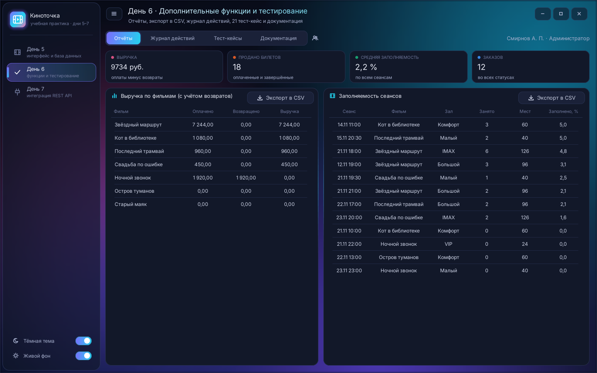
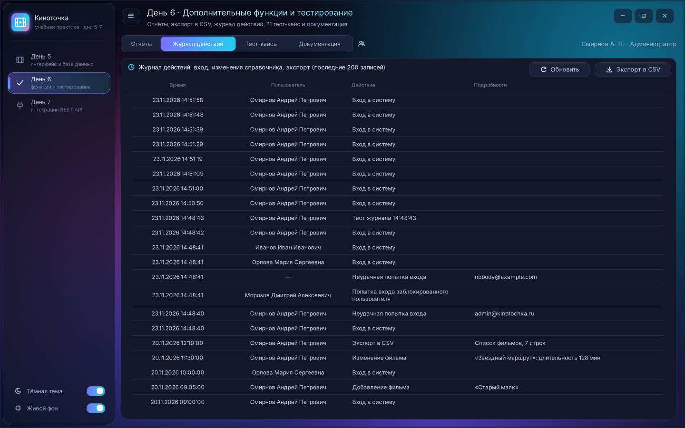
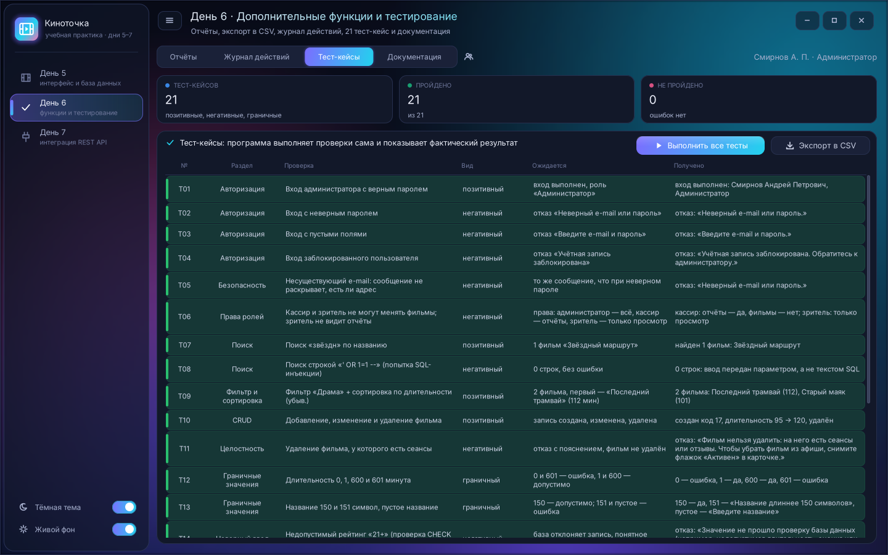
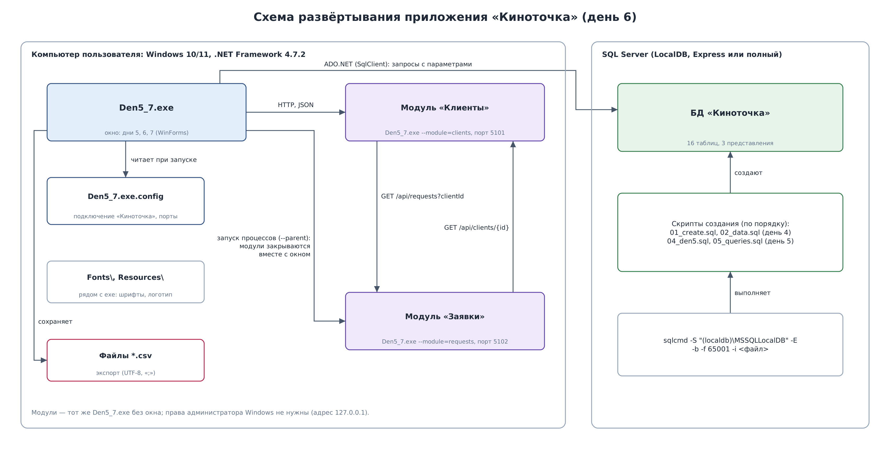

# День 6. Дополнительные функции, тестирование и документация

## 1. Дополнительные функции (не меньше 3)

| Функция | Где в программе | Кому доступна |
|---|---|---|
| Отчёт о выручке по фильмам (оплаты минус возвраты) | день 6 → «Отчёты» | администратор, кассир |
| Отчёт о заполняемости сеансов (занято / мест, %) | день 6 → «Отчёты» | администратор, кассир |
| Экспорт в CSV (UTF-8 с BOM, разделитель «;» — открывается в Excel) | «Отчёты», «Фильмы», «Словарь данных», «Тест-кейсы» | по правам раздела |
| Журнал действий: вход, неудачные попытки, добавление, изменение, удаление, экспорт, запуск тестов | день 6 → «Журнал действий», таблица `ЖурналДействий` | только администратор |
| Тест-кейсы, выполняемые самой программой, с отчётом | день 6 → «Тест-кейсы» | все |





## 2. Тест-кейсы

21 тест-кейс (позитивные, негативные, граничные) выполняются кнопкой «Выполнить все тесты» и из командной строки:

```
Den5_7.exe --run-tests=отчёт.md
```

Тестовые записи создаются и удаляются в ходе проверок — данные базы не меняются. Последний прогон: **21 из 21 пройдено**, полная таблица — [Тест-кейсы_день6.md](Тест-кейсы_день6.md).

| Что проверено | Тест-кейсы |
|---|---|
| Авторизация (верный, неверный, пустой пароль, блокировка, не раскрывается наличие e-mail) | T01–T05, T21 |
| Права ролей (администратор, кассир, зритель) | T06 |
| CRUD (добавление, изменение, удаление) | T10, T16 |
| Поиск, фильтр, сортировка, SQL-инъекция | T07–T09, T17 |
| Целостность данных (FK, CHECK) | T11, T14, T15 |
| Граничные значения (длительность 0/1/600/601, название 150/151 символ) | T12, T13 |
| Нет подключения к базе: сообщение без строки подключения и пароля | T18 |
| Экспорт CSV, журнал | T19, T20 |



## 3. Обработка исключений и устойчивость

* Все ошибки SQL Server переводятся в понятные сообщения (`Data/Db.cs`): нарушение связи (547), проверки CHECK, уникальности (2601, 2627), пустое обязательное поле (515), длинное значение (2628, 8152), блокировка (1205), нет подключения. В сообщениях нет строки подключения, пароля и текста SQL.
* Ошибки, не перехваченные на месте, ловят обработчики `Application.ThreadException` и `AppDomain.UnhandledException`: программа показывает сообщение и продолжает работу.
* Ввод проверяется до обращения к базе (`FilmValidator`), строка поиска передаётся параметром длиной до 200 символов, e-mail при входе — не длиннее 100 символов (иначе сразу «Неверный e-mail или пароль»).
* Модули дня 7 не падают от ошибки одного запроса (ответ 500, модуль работает дальше) и закрываются вместе с окном.

## 4. Найденные и исправленные ошибки

| № | Ошибка | Как найдена | Исправление |
|---|---|---|---|
| 1 | При недоступном сервере выводилось «Ошибка базы данных (код 0)» | тест T18 | ошибки открытия соединения объясняются как отсутствие подключения |
| 2 | Длинное ФИО в строке вкладок обрезалось | просмотр экранов | показывается «Фамилия И. О.» |
| 3 | Подсказка с тестовыми учётными записями не помещалась на экране входа | просмотр экранов | карточка входа увеличена |
| 4 | Вкладка «Карточка», открытая напрямую, оставалась незаполненной | ручная проверка | готовится карточка нового фильма |
| 5 | Кнопка «Выйти» завершала сеанс без вопроса | проверка по карте экранов | подтверждение «Выйти из системы?» |
| 6 | День 7: e-mail клиентов обрезался, карточка клиента открывалась пустой | просмотр экранов | столбец расширен, первый клиент показывается сразу |
| 7 | День 7: после аварийного закрытия окна модули оставались работать и занимали порты | проверка устойчивости | модуль следит за программой (`--parent`) и завершается вместе с ней |
| 8 | Повторный запуск `01_create.sql` после `04_den5.sql` падал: таблицы дня 5 ссылаются на Пользователи | повторное развёртывание | скрипт сначала удаляет объекты дня 5; все скрипты можно запускать повторно |
| 9 | День 7, Windows: при остановленном модуле «Клиенты» создание заявки отвечало «нет ответа» вместо 503 — вложенный вызов между модулями ждал столько же (3 с), сколько и клиент | тест И09 при сборке на Windows | вызов между модулями ждёт 2 с, клиент — 5 с; ответ 503 приходит вовремя |

## 5. Инструкция пользователя

1. Распакуйте `Den5_7_exe.zip` и запустите `Den5_7.exe`. Слева — дни 5, 6 и 7, сверху — разделы дня; кнопка «☰» (три полоски) сворачивает панель.
2. **Вход:** день 5 → «Вход», введите e-mail и пароль, нажмите «Войти» или Enter. Тестовые учётные записи (пароль у всех `123456`): `admin@kinotochka.ru` — администратор, `cashier1@kinotochka.ru` — кассир, `ivanov@example.com` — зритель, `morozov@example.com` — заблокирован.
3. **Справочник:** «Фильмы» — поиск по названию и описанию, фильтр по жанру, сортировка, флажок «только в прокате».
4. **Изменение:** щелчком выберите строку, нажмите «Изменить» (только администратор). «Добавить» открывает пустую карточку, «Удалить» спрашивает подтверждение.
5. **Отчёты и экспорт:** день 6 → «Отчёты», кнопка «Экспорт в CSV» сохраняет таблицу для Excel.
6. **Интеграция:** день 7 → «Модули» → «Запустить оба модуля», затем «Клиенты», «Новая заявка», «Тесты интеграции».
7. **Выход:** кнопка «Выйти» справа сверху (день 5), затем закрытие окна — модули дня 7 закрываются вместе с ним.

## 6. Инструкция по развёртыванию



**Требования:** Windows 10/11, .NET Framework 4.7.2 (есть в Windows 10/11), SQL Server 2017 или новее — подходит LocalDB из Visual Studio или SQL Server Express. Права администратора Windows не нужны.

**База данных** — выполнить по порядку (повторный запуск безопасен):

```
sqlcmd -S "(localdb)\MSSQLLocalDB" -E -b -f 65001 -i sql\01_create.sql
sqlcmd -S "(localdb)\MSSQLLocalDB" -E -b -f 65001 -i sql\02_data.sql
sqlcmd -S "(localdb)\MSSQLLocalDB" -E -b -f 65001 -i sql\04_den5.sql
sqlcmd -S "(localdb)\MSSQLLocalDB" -E -b -f 65001 -i sql\05_queries.sql
```

Можно и в SQL Server Management Studio: File → Open → файл → Execute (F5), в том же порядке.

**Строка подключения** — файл `Den5_7.exe.config`, раздел `connectionStrings`, имя «Киноточка». Для SQL Server Express замените `(localdb)\MSSQLLocalDB` на `.\SQLEXPRESS`. Порты модулей дня 7 — `appSettings`: `ClientsPort` (5101) и `RequestsPort` (5102).

**Сборка из исходников:** открыть `src/Den5_7.sln` в Visual Studio 2019/2022 → конфигурация Release → «Собрать решение»; результат — `src/Den5_7/bin/Release`.

## 7. Сценарий демонстрации (5–7 минут)

| Время | Действия |
|---|---|
| 1 мин | день 5 → «Вход»: неверный пароль (сообщение), затем вход администратором |
| 1 мин | «Главная» — сводка и афиша; «Фильмы» — поиск «звёзд», фильтр «Драма», сортировка, флажок «только в прокате» |
| 1,5 мин | «Добавить» → пустое название (проверка) → заполнить и сохранить; «Изменить»; «Удалить» фильм с сеансами — понятный отказ |
| 1 мин | «SQL-запросы» (13 запросов, параметры) и «Словарь данных» |
| 1 мин | день 6 — отчёты и экспорт в CSV, журнал действий, «Выполнить все тесты» (21 проверка) |
| 1,5 мин | день 7 — «Модули» → «Запустить оба», «Клиенты» → карточка с заявками, «Новая заявка» для клиента 999 (ошибка 422), «Тесты интеграции» |

## 8. Проверка комплектности

| Что | Где |
|---|---|
| Исходный код | `src/` (решение `Den5_7.sln`) |
| Готовая программа | релиз: `Den5_7_exe.zip` |
| Скрипты базы | `sql/` (01, 02 — день 4; 04, 05 — день 5) |
| Диаграммы (IDEF0, карта экранов, ER, развёртывание, интеграция, последовательность) | `docs/diagrams/` — .drawio, .png, .svg, .pdf |
| Макеты экранов | `docs/screens/` |
| Словарь данных, результаты запросов | `docs/Словарь_данных.md`, `docs/Результаты_запросов.md` |
| Тест-кейсы и результаты | `docs/Тест-кейсы_день6.md`, `docs/Тесты_интеграции_день7.md` |
| Контракт API | `docs/openapi.yaml`, `docs/День7_интеграция_REST.md` |
| Инструкции пользователя и по развёртыванию, сценарий защиты | этот файл |
| Пояснительная записка | `docs/Пояснительная_записка.pdf` |
