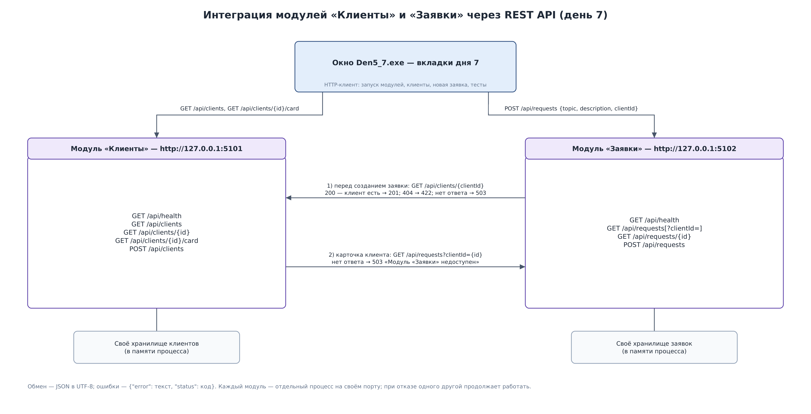
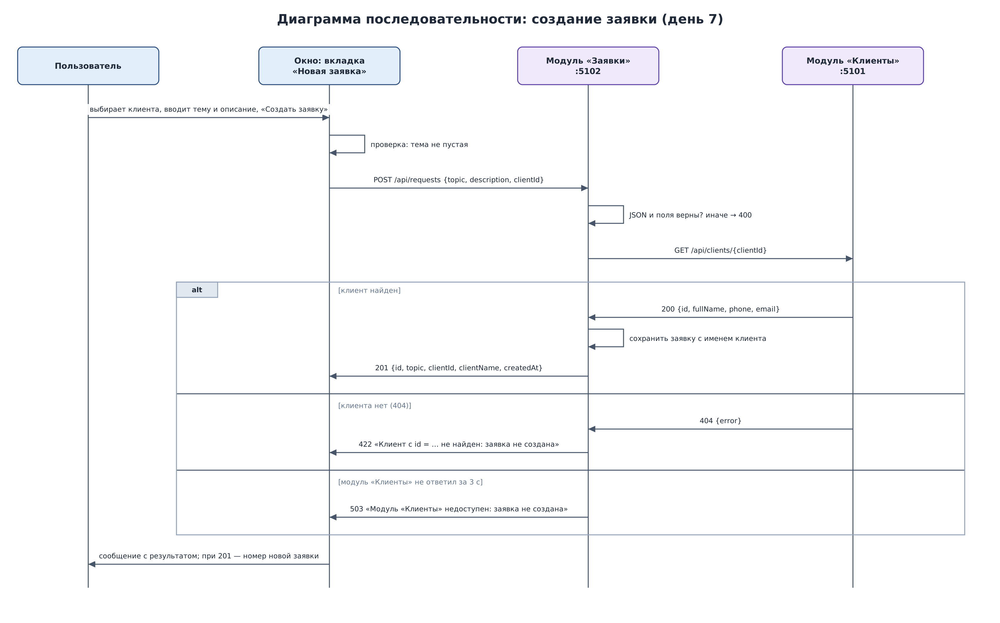
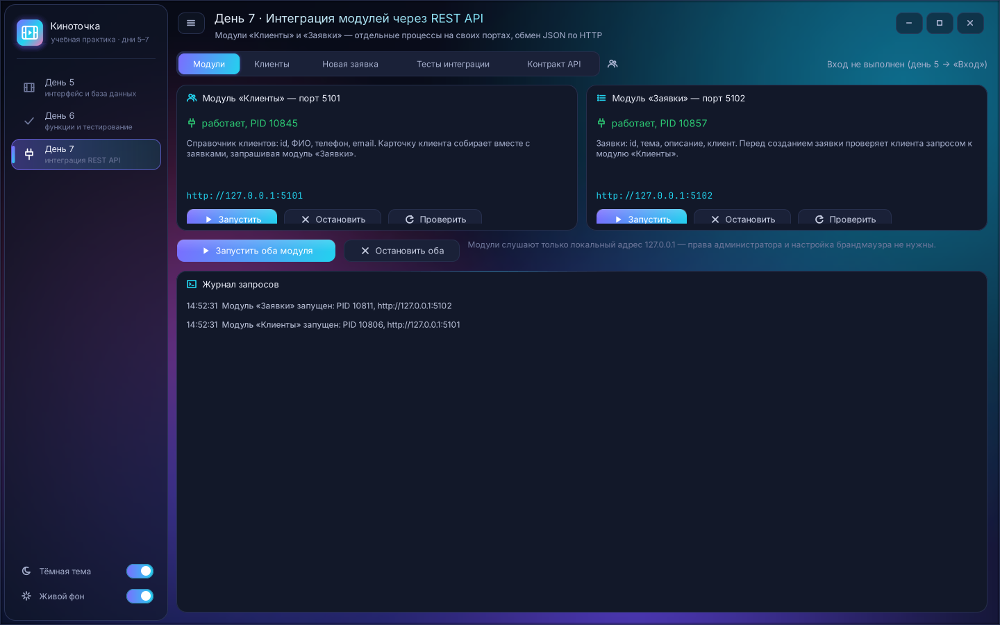
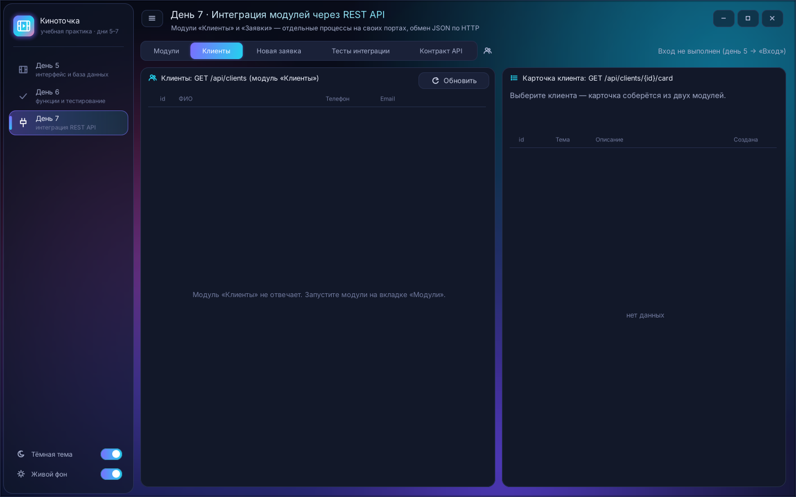
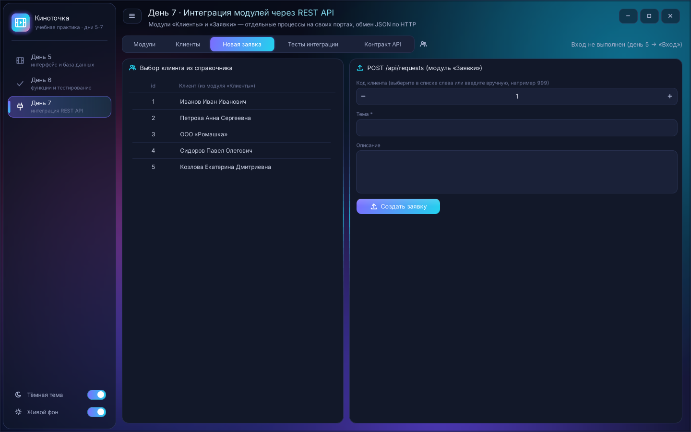
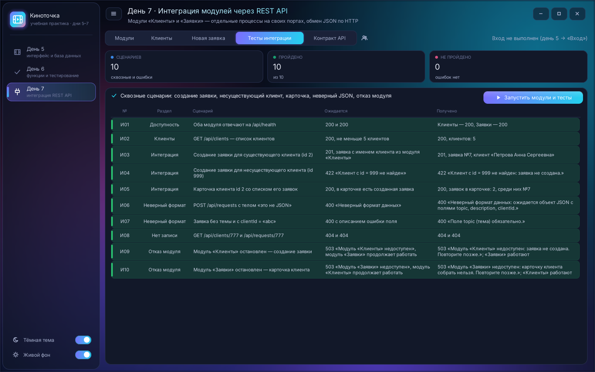

# День 7. Интеграция модулей через REST API

Вариант 1: модули **«Клиенты»** и **«Заявки»**. Каждый модуль — отдельный процесс на своём порту со своим хранилищем; обмен — JSON по HTTP. Модули — тот же `Den5_7.exe`, запущенный без окна с параметром `--module`.



## 1. Как работает интеграция

* **Создание заявки** (`POST /api/requests` в модуль «Заявки»): модуль проверяет JSON и поля, затем запрашивает клиента у модуля «Клиенты» (`GET /api/clients/{clientId}`):
  * клиент есть (200) → заявка сохраняется с именем клиента → **201**;
  * клиента нет (404) → **422** «Клиент с id = … не найден: заявка не создана»;
  * модуль «Клиенты» не ответил за 3 секунды → **503** «Модуль «Клиенты» недоступен», модуль «Заявки» продолжает работать.
* **Карточка клиента** (`GET /api/clients/{id}/card` в модуль «Клиенты»): модуль берёт клиента из своего хранилища и его заявки у модуля «Заявки» (`GET /api/requests?clientId={id}`). Если модуль «Заявки» недоступен — **503**.



## 2. Контракт API

Полное описание — [openapi.yaml](openapi.yaml) (OpenAPI 3.0, открывается в editor.swagger.io). Ошибки — объект `{"error": "текст", "status": код}`.

| Модуль | Метод и путь | Тело запроса | Ответы |
|---|---|---|---|
| Клиенты :5101 | `GET /api/health` | — | 200 `{module, status}` |
| Клиенты | `GET /api/clients` | — | 200 `[{id, fullName, phone, email}]` |
| Клиенты | `GET /api/clients/{id}` | — | 200 клиент; 400 неверный id; 404 нет клиента |
| Клиенты | `GET /api/clients/{id}/card` | — | 200 `{client, requests[], requestsCount}`; 404; 503 модуль «Заявки» недоступен |
| Клиенты | `POST /api/clients` | `{fullName, phone, email}` | 201 клиент; 400 неверные данные |
| Заявки :5102 | `GET /api/health` | — | 200 `{module, status}` |
| Заявки | `GET /api/requests?clientId={id}` | — | 200 `[{id, topic, description, clientId, clientName, createdAt}]`; 400 неверный clientId |
| Заявки | `GET /api/requests/{id}` | — | 200 заявка; 400; 404 нет заявки |
| Заявки | `POST /api/requests` | `{topic, description, clientId}` | 201 заявка; 400 неверный JSON или поля; 422 клиента нет; 503 модуль «Клиенты» недоступен |
| Оба | любой другой адрес или метод | — | 404 / 405; 500 — внутренняя ошибка, модуль продолжает работать |

Правила полей: `topic` обязательна, до 200 символов; `description` до 2000 символов; `clientId` — целое число больше 0; `fullName` обязательно, до 150 символов; `email` — по шаблону.

## 3. Запуск

**Из программы:** день 7 → «Модули» → «Запустить оба модуля». Статус обновляется каждые 2 секунды; модули закрываются вместе с окном.

**Вручную** (каждый в своём окне командной строки):

```
Den5_7.exe --module=clients  --port=5101 --peer=http://127.0.0.1:5102
Den5_7.exe --module=requests --port=5102 --peer=http://127.0.0.1:5101
```

Порты задаются в `Den5_7.exe.config` (`ClientsPort`, `RequestsPort`). Модули слушают только адрес 127.0.0.1 — права администратора и настройка брандмауэра не нужны.

## 4. Пример обмена (реальные ответы модулей)

```
$ curl http://127.0.0.1:5101/api/clients/2
{"id":2,"fullName":"Петрова Анна Сергеевна","phone":"+7 900 222-33-44","email":"petrova@example.com"}
→ 200

$ curl -X POST http://127.0.0.1:5102/api/requests -d {"topic":"Возврат билета","description":"Сеанс перенесли","clientId":2}
{"id":7,"topic":"Возврат билета","description":"Сеанс перенесли","clientId":2,"clientName":"Петрова Анна Сергеевна","createdAt":"2026-11-23T14:49:59"}
→ 201

$ curl -X POST http://127.0.0.1:5102/api/requests -d {"topic":"Проверка","clientId":999}
{"error":"Клиент с id = 999 не найден: заявка не создана.","status":422}
→ 422

$ curl -X POST http://127.0.0.1:5102/api/requests -d "это не JSON"
{"error":"Неверный формат данных: ожидается объект JSON с полями topic, description, clientId.","status":400}
→ 400

$ curl http://127.0.0.1:5101/api/clients/2/card
{"client":{"id":2,"fullName":"Петрова Анна Сергеевна",...},"requests":[{"id":3,"topic":"День рождения",...},{"id":7,"topic":"Возврат билета",...}],"requestsCount":2}
→ 200

# модуль «Клиенты» остановлен
$ curl -X POST http://127.0.0.1:5102/api/requests -d {"topic":"Тест","clientId":1}
{"error":"Модуль «Клиенты» недоступен: заявка не создана. Повторите позже.","status":503}
→ 503
```

## 5. Тесты интеграции

10 сквозных сценариев: вкладка «Тесты интеграции» или командная строка (модули запускаются и останавливаются сами):

```
Den5_7.exe --run-integration=отчёт.md
```

Последний прогон: **10 из 10 пройдено**, таблица — [Тесты_интеграции_день7.md](Тесты_интеграции_день7.md).

| Сценарий | Тест |
|---|---|
| Оба модуля отвечают, список клиентов | И01, И02 |
| Сквозной сценарий: заявка для существующего клиента → видна в карточке клиента | И03, И05 |
| Несуществующий клиент → 422 | И04 |
| Неверный формат: не JSON, пустая тема, нечисловой clientId → 400 | И06, И07 |
| Нет записи → 404 | И08 |
| Недоступность модуля → 503, второй модуль работает | И09, И10 |

| Модули | Клиенты и карточка |
|---|---|
|  |  |
| **Новая заявка** | **Тесты интеграции** |
|  |  |
