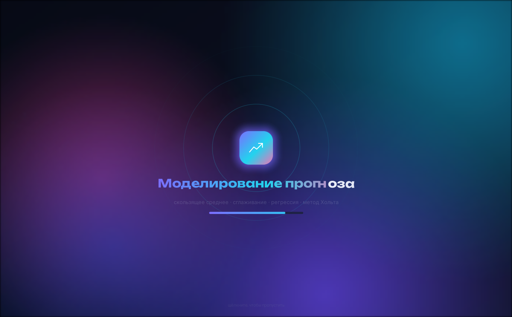
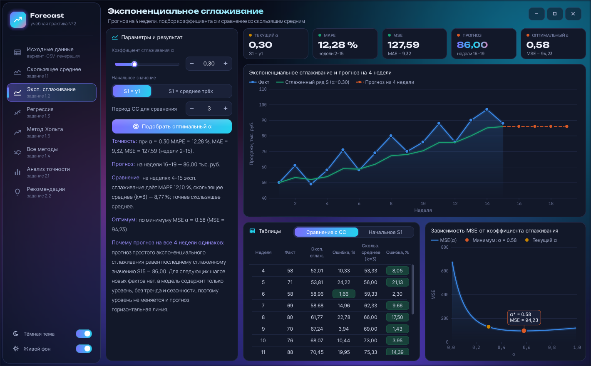
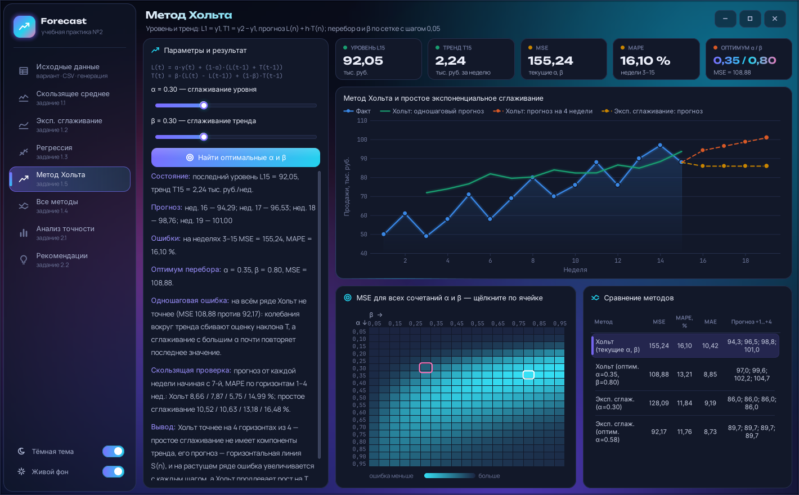
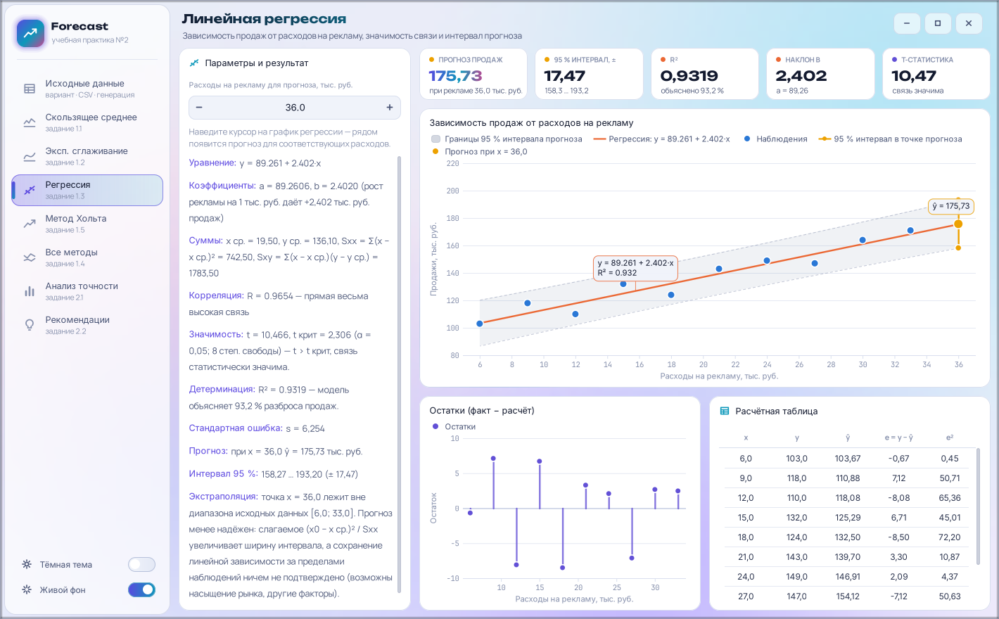
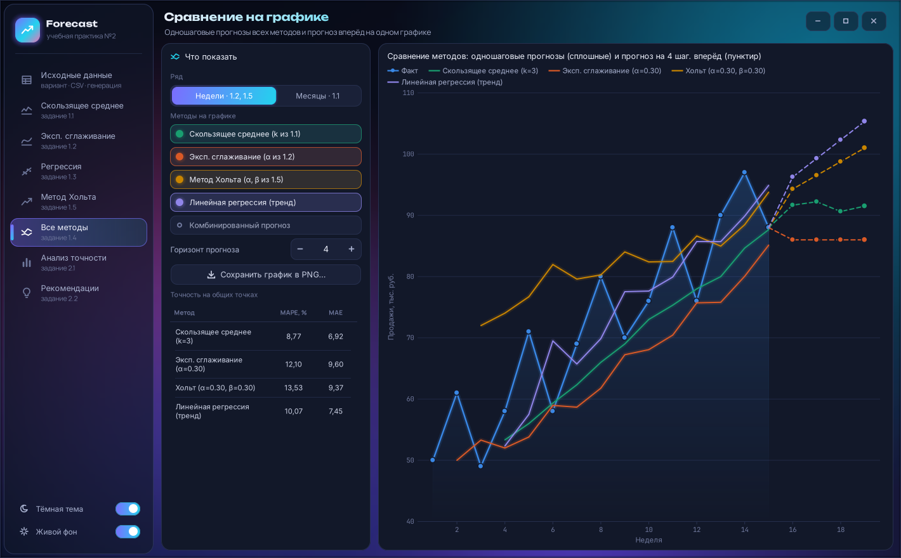
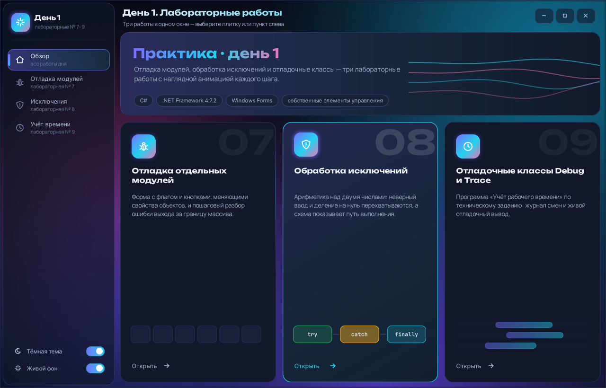
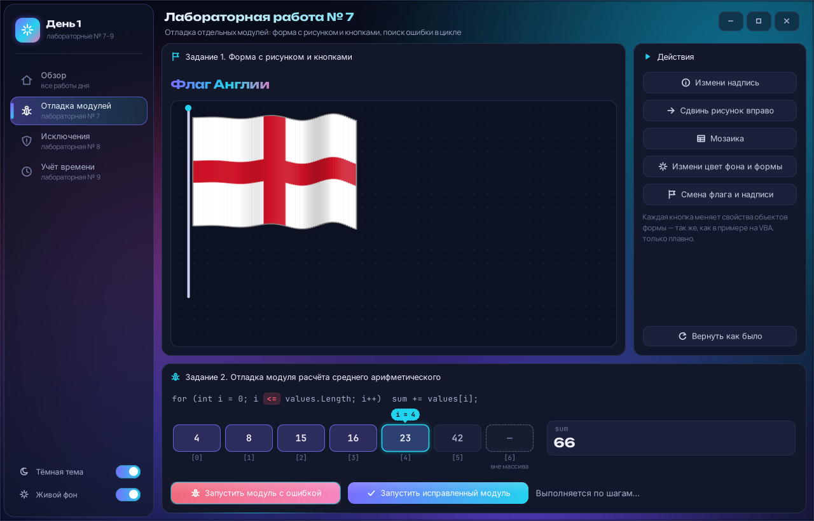
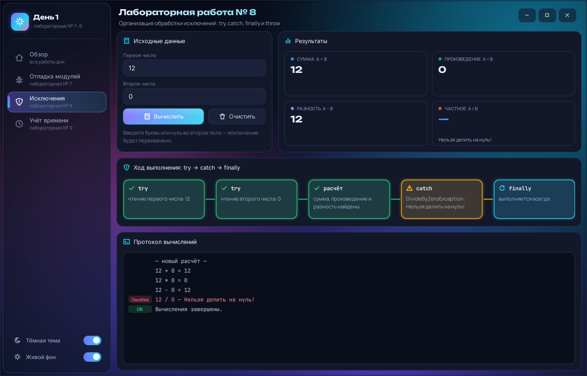
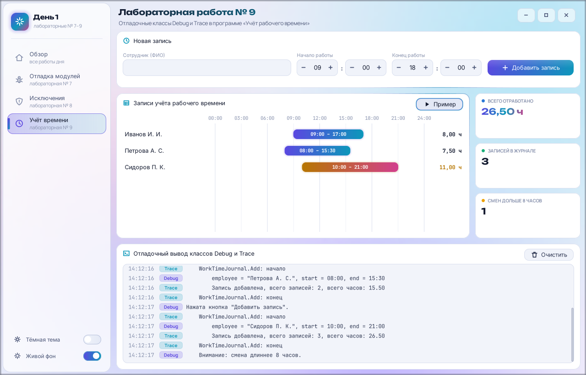

# Практика: два проекта Visual Studio с собственным анимированным интерфейсом

Оба проекта — **C#, Windows Forms, .NET Framework 4.7.2**, без сторонних библиотек.
Расчётная часть и логика лабораторных сохранены, а интерфейс полностью нарисован своими силами:
ни одной стандартной кнопки, таблицы или графика.

| Архив | Что внутри | Как открыть |
|---|---|---|
| [`Forecast.zip`](Forecast.zip) | Практика № 2 «Моделирование прогноза» | распаковать → `Forecast\Forecast.sln` → F5 |
| [`Den1.zip`](Den1.zip) | День 1, лабораторные работы № 7–9 | распаковать → `Den1\Den1.sln` → F5 |

Те же архивы и готовые к запуску программы (exe) лежат на странице **Releases**.
Исходники в развёрнутом виде — папки [`Forecast`](Forecast) и [`Den1`](Den1).

## День 1 — анализ предметной области и UML

Папка [`UML_Den1`](UML_Den1): кинотеатр «Киноточка» (онлайн-продажа билетов) — описание предметной области,
диаграмма вариантов использования и диаграмма деятельности «Покупка билета онлайн».
Редактируемые исходники — `.drawio`, экспорт — PNG и PDF, сводный отчёт — `Отчёт_День1_UML.pdf`.

## День 2 — моделирование состояний и классов

Папка [`UML_Den2`](UML_Den2): диаграмма состояний объекта «Заказ», диаграмма классов (10 классов, 2 перечисления)
и проверка согласованности с вариантами использования дня 1. Отчёт — `Отчёт_День2_UML.pdf`.

## Forecast — моделирование прогноза

## День 1 — лабораторные № 7–9

## Что сделано в оформлении

Общая библиотека **FxKit** (папка `Fx` в каждом проекте, около 4 тысяч строк):

- **Окно** без системной рамки: свой заголовок и кнопки, перетаскивание, изменение размера, тень.
- **«Живой» фон** — медленно плывущие цветные пятна под стеклянной боковой панелью и между карточками.
- **Заставка** при запуске: название появляется по буквам, затем интерфейс раскрывается кругом из центра.
- **Тёмная и светлая темы**; смена темы — круговое раскрытие из точки переключателя.
- **Переходы между разделами**: старая страница растворяется и уезжает, новая проявляется; затем графики,
  таблицы, плитки и текст появляются каскадом.
- **Графики** собственной отрисовки: линии прорисовываются слева направо, столбцы вырастают,
  при движении ползунка ряды и оси плавно перетекают в новое состояние; перекрестие и подсказка под курсором.
- **Тепловая карта** α–β для метода Хольта: рамка текущих параметров переезжает по карте, щелчок выбирает ячейку.
- **Элементы управления**: кнопки с «волной» от нажатия, скользящий переключатель вариантов, ползунок,
  числовое поле, «чипы», таблицы с каскадным появлением строк и редактированием, плитки с «докручиванием» чисел,
  всплывающие уведомления вместо `MessageBox`, подсветка рамки карточки рядом с курсором.
- **Свои шрифты**: Manrope, Unbounded, JetBrains Mono (лицензия OFL, файлы в папке `Fonts`).

В лабораторных дополнительно: развевающийся флаг с переворотом и мозаикой, пошаговый «отладчик» цикла
с выходом за границу массива, схема `try → catch → finally`, лента смен на шкале суток и консоль,
помечающая строки `Debug` и `Trace`.

## Проверка

- Оба проекта компилируются под .NET Framework 4.7.2 (C# 7.3) без ошибок и предупреждений.
- Каждая сборка на GitHub выполняется настоящим MSBuild на Windows (см. вкладку **Actions**),
  готовые exe прикладываются к релизу.
- Интерфейс прогнан на всех страницах в обеих темах; снимки выше сняты с работающих программ.

Размер окна подстраивается под экран; при масштабе Windows 125–150 % изображение растягивается системой
(программы не объявляют поддержку высокого DPI, как и исходные проекты).
