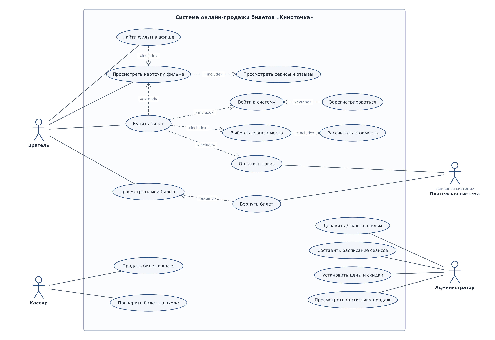

# День 1. Анализ предметной области и UML-диаграммы

**Предметная область:** кинотеатр, система онлайн-продажи билетов «Киноточка».

## Задание 1. Описание предметной области

### Назначение системы

«Киноточка» — информационная система кинотеатра для продажи билетов через сайт и в кассе.
Зритель может посмотреть афишу, выбрать сеанс и места на схеме зала, оплатить заказ картой и получить
электронный билет с QR-кодом. Сотрудники кинотеатра ведут репертуар и расписание, продают и проверяют
билеты, смотрят статистику продаж. Система исключает двойную продажу места и сокращает очереди в кассе.

### Пользователи (роли)

| Роль | Кто это | Что делает в системе |
|---|---|---|
| **Зритель** | посетитель сайта кинотеатра | ищет фильм в афише, смотрит карточку фильма, покупает билет (для покупки нужен вход или регистрация), смотрит свои билеты и возвращает их |
| **Кассир** | сотрудник кассы кинотеатра | продаёт билеты в кассе, проверяет билеты на входе в зал |
| **Администратор** | менеджер кинотеатра | добавляет и скрывает фильмы, составляет расписание, устанавливает цены и скидки, смотрит статистику продаж |
| **Платёжная система** | внешний сервис банка (не человек) | проводит оплату заказа и возврат денег |

### Основные функции системы

1. Поиск фильма в афише по названию, дате и жанру.
2. Просмотр карточки фильма: описание, сеансы, отзывы.
3. Вход и регистрация (нужны только для покупки).
4. Выбор сеанса и мест на схеме зала, расчёт стоимости со скидкой.
5. Онлайн-оплата и выдача электронного билета с QR-кодом.
6. Просмотр своих билетов и возврат билета.
7. Продажа билетов в кассе и проверка билетов на входе.
8. Ведение афиши, расписания, цен и статистика продаж.

### Данные, которые нужно хранить

- **Фильмы:** название, жанр, длительность, возрастное ограничение, описание, постер.
- **Залы:** номер, схема мест (ряды, места, тип места: обычное, VIP, диван).
- **Сеансы:** фильм, зал, дата и время начала, формат (2D/3D).
- **Тарифы и промокоды:** цена по типу места и времени сеанса; скидка, срок действия промокода.
- **Пользователи:** ФИО, e-mail, телефон, пароль (в виде хеша), роль.
- **Заказы:** зритель, сеанс, места, сумма, статус (создан / оплачен / отменён / возвращён), время создания.
- **Билеты:** заказ, место, уникальный QR-код, отметка о проходе в зал.
- **Платежи:** заказ, сумма, идентификатор транзакции банка, статус, дата.

## Задание 2. Диаграмма вариантов использования

На диаграмме 4 актора и 17 вариантов использования внутри границы системы.
Связи выстроены в том порядке, в каком зритель действует на самом деле: **нашёл фильм → открыл карточку → купил билет**.

- «Найти фильм в афише» **включает** (`«include»`) «Просмотреть карточку фильма», а карточка включает «Просмотреть сеансы и отзывы».
- «Купить билет» **расширяет** (`«extend»`) «Просмотреть карточку фильма»: покупка начинается с карточки и только если зритель решил купить.
- «Купить билет» включает «Войти в систему», «Выбрать сеанс и места» и «Оплатить заказ»; выбор мест включает «Рассчитать стоимость».
- «Зарегистрироваться» расширяет «Войти в систему»: нужна, только если у зрителя нет аккаунта.
- «Вернуть билет» расширяет «Просмотреть мои билеты»: возврат делается из списка своих билетов.
- Платёжная система участвует в вариантах «Оплатить заказ» и «Вернуть билет».

## Задание 3. Диаграмма деятельности: «Покупка билета онлайн»

Процесс разбит на три дорожки: **Зритель**, **Система «Киноточка»** и **Платёжная система**.

**Основной сценарий.** Зритель открывает афишу и вводит запрос (название, дата, жанр) → система находит фильмы →
зритель выбирает фильм и открывает карточку → решает купить билет → система проверяет, выполнен ли вход →
зритель выбирает дату и сеанс → система показывает схему зала → зритель выбирает места → система проверяет,
что места свободны, блокирует их на 15 минут и считает стоимость со скидкой → зритель проверяет заказ и
оплачивает картой → платёжная система проводит платёж → система оформляет билеты с QR-кодами и отправляет
их на e-mail → зритель получает электронный билет.

**Ветвления и альтернативные сценарии:**

1. *Фильмы не найдены* — система сообщает «Ничего не найдено», зритель вводит другой запрос.
2. *Зритель передумал покупать* — возвращается к поиску и выбирает другой фильм.
3. *Вход не выполнен* — зритель входит в аккаунт или регистрируется; проверка идёт только когда он решил купить билет, смотреть афишу можно без входа.
4. *Места уже заняты* (их купил кто-то другой) — система сообщает об этом, обновляет схему, зритель выбирает места заново.
5. *Оплата отклонена* — если 15 минут брони не истекли, зритель повторяет оплату.
6. *Время брони истекло* — система снимает блокировку мест и отменяет заказ, зритель получает уведомление; процесс завершается без покупки.

## Файлы

| Файл | Что это |
|---|---|
| `usecase.drawio`, `activity.drawio` | **редактируемые** диаграммы — открыть на [app.diagrams.net](https://app.diagrams.net) или в draw.io Desktop |
| `usecase.png`, `activity.png` | экспорт в PNG |
| `usecase.pdf`, `activity.pdf` | экспорт в PDF (векторный) |
| `usecase.svg`, `activity.svg` | векторные изображения |
| `Отчёт_День1_UML.pdf` | готовый отчёт: описание предметной области, обе диаграммы, описание акторов и процесса |
| `tools/build_diagrams.py` | скрипт, которым диаграммы сгенерированы (`pip install cairosvg`, затем `python tools/build_diagrams.py`) |
