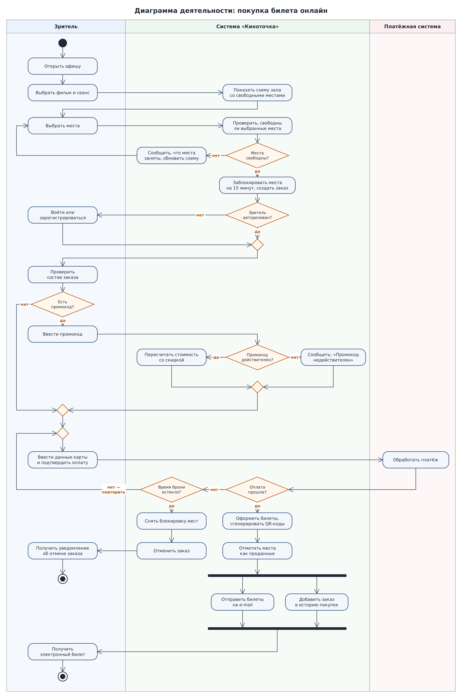

# День 1. Анализ предметной области и UML-диаграммы

**Предметная область:** кинотеатр, система онлайн-продажи билетов «Киноточка».

## Задание 1. Описание предметной области

### Назначение системы

«Киноточка» — информационная система кинотеатра для продажи билетов через сайт и в кассе.
Зритель может посмотреть афишу, выбрать сеанс и места на схеме зала, оплатить заказ картой и получить
электронный билет с QR-кодом. Сотрудники кинотеатра ведут репертуар и расписание, продают и проверяют
билеты, смотрят статистику продаж. Система исключает двойную продажу места и сокращает очереди в кассе.

### Пользователи (роли)

| Роль | Кто это | Что делает в системе |
|---|---|---|
| **Гость** | любой посетитель сайта без входа в аккаунт | смотрит афишу, ищет фильм, смотрит схему зала, регистрируется |
| **Зритель** | зарегистрированный покупатель (наследует всё, что может гость) | покупает и возвращает билеты, смотрит историю покупок |
| **Кассир** | сотрудник кассы кинотеатра | продаёт билеты в кассе, оформляет возврат, проверяет билеты на входе в зал |
| **Администратор** | менеджер кинотеатра | добавляет фильмы, составляет расписание, устанавливает цены, формирует отчёты |
| **Платёжная система** | внешний сервис банка (не человек) | проводит оплату заказа и возврат денег |

### Основные функции системы

1. Просмотр афиши и поиск фильма.
2. Выбор сеанса и мест на интерактивной схеме зала.
3. Оформление и онлайн-оплата заказа (с промокодом), выдача электронного билета с QR-кодом.
4. Возврат билета с возвратом денег на карту.
5. Продажа билетов в кассе и проверка билетов на входе.
6. Ведение репертуара, расписания сеансов и цен.
7. Отчёты о продажах и заполняемости залов.

### Данные, которые нужно хранить

- **Фильмы:** название, жанр, длительность, возрастное ограничение, описание, постер.
- **Залы:** номер, схема мест (ряды, места, тип места: обычное, VIP, диван).
- **Сеансы:** фильм, зал, дата и время начала, формат (2D/3D).
- **Тарифы и промокоды:** цена по типу места и времени сеанса; скидка, срок действия промокода.
- **Пользователи:** ФИО, e-mail, телефон, пароль (в виде хеша), роль.
- **Заказы:** зритель, сеанс, места, сумма, статус (создан / оплачен / отменён / возвращён), время создания.
- **Билеты:** заказ, место, уникальный QR-код, отметка о проходе в зал.
- **Платежи:** заказ, сумма, идентификатор транзакции банка, статус, дата.

## Задание 2. Диаграмма вариантов использования

На диаграмме 5 акторов и 18 вариантов использования внутри границы системы.

- **Зритель → Гость** — обобщение: зритель может делать всё то же, что и гость.
- «Купить билет» **включает** (`«include»`) «Выбрать сеанс», «Выбрать места», «Оплатить заказ» и
  «Отправить билет на e-mail»: без этих шагов покупка не бывает.
- «Продать билет в кассе» тоже включает «Выбрать места»: тот же шаг используется повторно.
- «Применить промокод» **расширяет** (`«extend»`) «Оплатить заказ»: выполняется только когда у зрителя есть промокод.
- Платёжная система участвует в вариантах «Оплатить заказ» и «Вернуть билет».

## Задание 3. Диаграмма деятельности: «Покупка билета онлайн»

Процесс разбит на три дорожки: **Зритель**, **Система «Киноточка»** и **Платёжная система**.

**Основной сценарий.** Зритель открывает афишу, выбирает фильм и сеанс → система показывает схему зала →
зритель выбирает места → система проверяет, что места свободны, блокирует их на 15 минут и создаёт заказ →
зритель проверяет заказ и вводит данные карты → платёжная система проводит платёж → система оформляет
билеты с QR-кодами и отмечает места как проданные, затем параллельно отправляет билеты на e-mail и
добавляет заказ в историю → зритель получает электронный билет.

**Ветвления и альтернативные сценарии:**

1. *Места уже заняты* (их купил кто-то другой) — система сообщает об этом, обновляет схему, зритель выбирает места заново.
2. *Зритель не авторизован* — он входит в аккаунт или регистрируется, после чего процесс продолжается.
3. *Есть промокод* — система проверяет его: действительный промокод даёт скидку, недействительный — сообщение об ошибке, оплата идёт по полной цене.
4. *Оплата отклонена* — если 15 минут брони не истекли, зритель может повторить оплату.
5. *Время брони истекло* — система снимает блокировку мест, отменяет заказ, зритель получает уведомление; процесс завершается без покупки.

## Файлы

| Файл | Что это |
|---|---|
| `usecase.drawio`, `activity.drawio` | **редактируемые** диаграммы — открыть на [app.diagrams.net](https://app.diagrams.net) или в draw.io Desktop |
| `usecase.png`, `activity.png` | экспорт в PNG |
| `usecase.pdf`, `activity.pdf` | экспорт в PDF (векторный) |
| `usecase.svg`, `activity.svg` | векторные изображения |
| `Отчёт_День1_UML.pdf` | готовый отчёт: описание предметной области, обе диаграммы, описание акторов и процесса |
| `tools/build_diagrams.py` | скрипт, которым диаграммы сгенерированы (`pip install cairosvg`, затем `python tools/build_diagrams.py`) |
