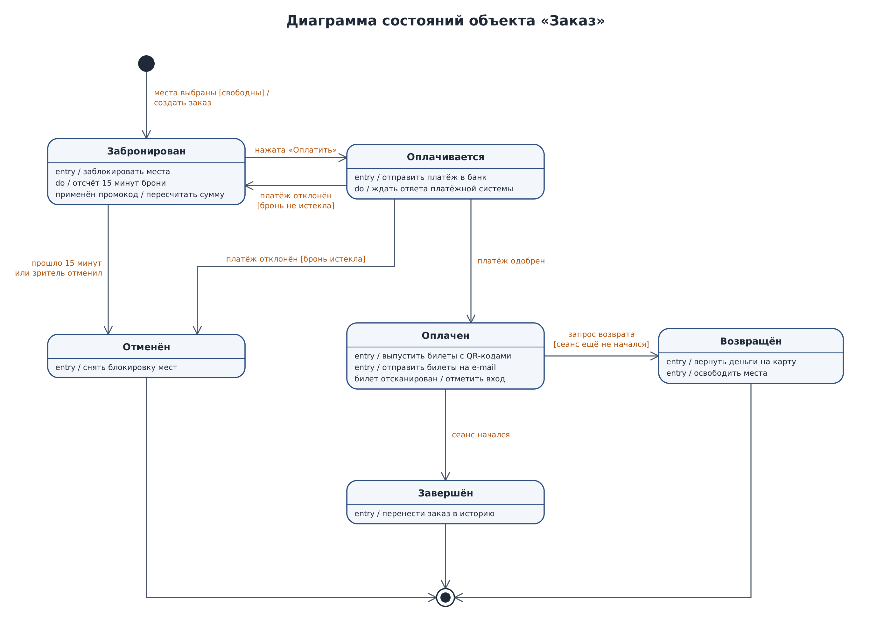
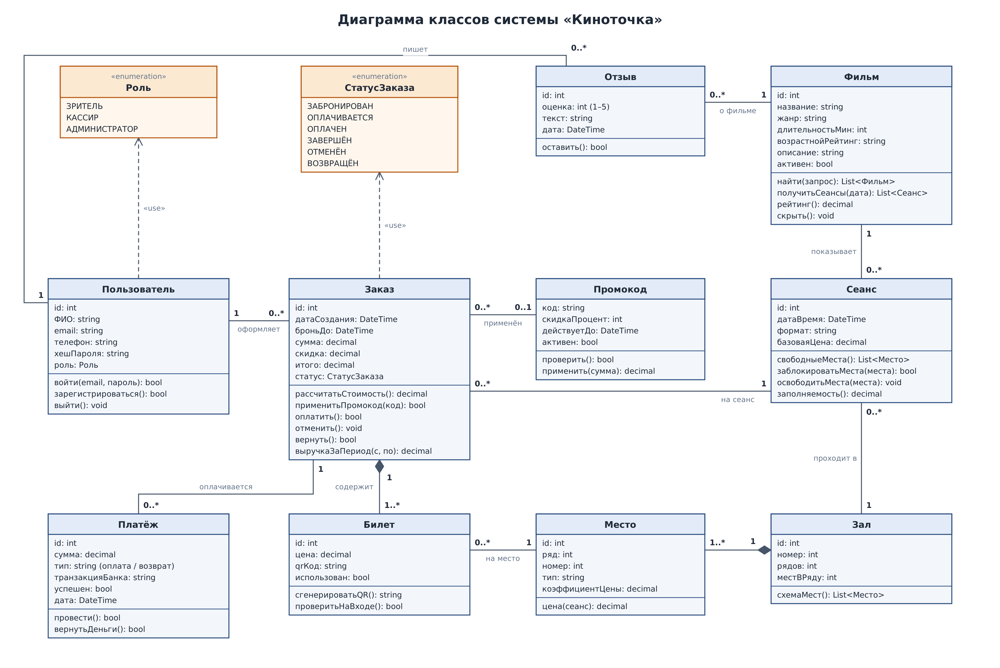

# День 2. Моделирование состояний и классов

**Предметная область:** кинотеатр «Киноточка», система онлайн-продажи билетов (продолжение [дня 1](../UML_Den1)).

## Задание 1. Диаграмма состояний

### Выбранный объект — «Заказ»

Заказ — главный объект системы: в нём сходятся зритель, сеанс, места, билеты и платежи.
От его состояния зависит, заняты ли места в зале, можно ли пройти по билету и вернуть деньги.
Поэтому для системы важно, чтобы заказ проходил только по разрешённым переходам: например, нельзя вернуть
неоплаченный заказ или оплатить заказ, бронь которого уже истекла.

### Состояния (6)

| Состояние | Что происходит |
|---|---|
| **Забронирован** | места заблокированы для зрителя, идёт отсчёт 15 минут брони; можно применить промокод |
| **Оплачивается** | платёж отправлен в банк, система ждёт ответа платёжной системы |
| **Оплачен** | выпущены билеты с QR-кодами и отправлены на e-mail; при сканировании билета на входе отмечается проход |
| **Завершён** | сеанс начался, заказ уходит в историю покупок (из него можно оставить отзыв) |
| **Отменён** | бронь истекла или зритель отменил заказ; блокировка мест снята |
| **Возвращён** | зритель вернул билеты до начала сеанса; деньги возвращены, места снова свободны |

### Переходы

Подписи переходов записаны в нотации UML: `событие [условие] / действие`.

| Из | В | Событие [условие] / действие |
|---|---|---|
| ● начало | Забронирован | места выбраны [свободны] / создать заказ |
| Забронирован | Оплачивается | нажата «Оплатить» |
| Оплачивается | Оплачен | платёж одобрен |
| Оплачивается | Забронирован | платёж отклонён [бронь не истекла] — можно повторить оплату |
| Оплачивается | Отменён | платёж отклонён [бронь истекла] |
| Забронирован | Отменён | прошло 15 минут или зритель отменил заказ |
| Оплачен | Возвращён | запрос возврата [сеанс ещё не начался] |
| Оплачен | Завершён | сеанс начался |
| Завершён, Отменён, Возвращён | ◉ конец | — |

Конечных состояний для заказа три: **Завершён**, **Отменён** и **Возвращён**; из них заказ уже не меняется.

## Задание 2. Диаграмма классов

10 классов и 2 перечисления. Типы данных — как в C#, на котором будет приложение (дни 5–6).

| Класс | Назначение |
|---|---|
| **Пользователь** | учётная запись: зритель, кассир или администратор (перечисление **Роль**); вход, регистрация, выход; пароль хранится только в виде хеша |
| **Фильм** | карточка фильма в афише; поиск, список сеансов на дату, средний рейтинг по отзывам, скрытие из афиши |
| **Сеанс** | показ фильма в зале в определённое время; свободные места, блокировка и освобождение мест, заполняемость |
| **Зал** | зал кинотеатра; отдаёт схему мест |
| **Место** | место в зале (ряд, номер, тип); цена места на сеансе = базовая цена × коэффициент |
| **Заказ** | покупка зрителя на один сеанс; расчёт стоимости, промокод, оплата, отмена, возврат; статус — перечисление **СтатусЗаказа** |
| **Билет** | билет на одно место в заказе; QR-код и проверка на входе |
| **Платёж** | операция в платёжной системе — оплата или возврат денег |
| **Промокод** | скидка в процентах со сроком действия |
| **Отзыв** | оценка и текст зрителя о фильме |

### Основные связи

- **Пользователь 1 — 0..\* Заказ** («оформляет»): у зрителя может быть много заказов, у заказа — один владелец.
- **Заказ ◆ 1 — 1..\* Билет** — *композиция*: билеты существуют только внутри заказа и удаляются вместе с ним; в заказе хотя бы один билет.
- **Билет 0..\* — 1 Место**: билет всегда на конкретное место; на одно место за всё время продаётся много билетов (на разные сеансы).
- **Заказ 0..\* — 1 Сеанс**: заказ оформляется на один сеанс.
- **Сеанс 0..\* — 1 Фильм** и **Сеанс 0..\* — 1 Зал**: у сеанса один фильм и один зал, у фильма и зала — много сеансов.
- **Зал ◆ 1 — 1..\* Место** — *композиция*: места — часть зала и без него не существуют.
- **Заказ 1 — 0..\* Платёж**: оплата может быть повторена после отказа банка, а при возврате появляется ещё один платёж.
- **Заказ 0..\* — 0..1 Промокод**: промокод необязателен, один промокод действует для многих заказов.
- **Пользователь 1 — 0..\* Отзыв** и **Отзыв 0..\* — 1 Фильм**: зритель пишет отзывы о фильмах.
- **Заказ ⇢ СтатусЗаказа** и **Пользователь ⇢ Роль** — зависимости от перечислений. Значения **СтатусЗаказа** совпадают с состояниями на диаграмме состояний.

## Задание 3. Проверка согласованности

### Варианты использования (день 1) → классы и методы

| Вариант использования | Актор | Классы и методы |
|---|---|---|
| Найти фильм в афише | Зритель | `Фильм.найти(запрос)` |
| Просмотреть карточку фильма | Зритель | `Фильм` (атрибуты карточки) |
| Просмотреть сеансы и отзывы | Зритель | `Фильм.получитьСеансы(дата)`, `Фильм.рейтинг()`, `Отзыв` |
| Купить билет | Зритель | `Заказ`, `Билет` |
| Войти в систему / Зарегистрироваться | Зритель | `Пользователь.войти()`, `Пользователь.зарегистрироваться()` |
| Выбрать сеанс и места | Зритель, Кассир | `Сеанс.свободныеМеста()`, `Сеанс.заблокироватьМеста()`, `Зал.схемаМест()` |
| Рассчитать стоимость | — | `Заказ.рассчитатьСтоимость()`, `Место.цена(сеанс)`, `Заказ.применитьПромокод()`, `Промокод.применить()` |
| Оплатить заказ | Зритель, Платёжная система | `Заказ.оплатить()`, `Платёж.провести()` |
| Просмотреть мои билеты | Зритель | связь `Пользователь — Заказ — Билет` |
| Вернуть билет | Зритель, Платёжная система | `Заказ.вернуть()`, `Платёж.вернутьДеньги()`, `Сеанс.освободитьМеста()` |
| Оставить отзыв | Зритель | `Отзыв.оставить()` |
| Продать билет в кассе | Кассир | `Заказ`, `Билет` (заказ оформляет `Пользователь` с ролью КАССИР) |
| Проверить билет на входе | Кассир | `Билет.проверитьНаВходе()` |
| Добавить / скрыть фильм | Администратор | `Фильм`, `Фильм.скрыть()` |
| Составить расписание сеансов | Администратор | `Сеанс` (дата, зал, фильм, формат) |
| Установить цены и скидки | Администратор | `Сеанс.базоваяЦена`, `Место.коэффициентЦены`, `Промокод` |
| Просмотреть статистику продаж | Администратор | `Заказ.выручкаЗаПериод(с, по)`, `Сеанс.заполняемость()` |

**Итог проверки.** Каждый вариант использования обеспечен хотя бы одним классом или методом, и у каждого класса
есть варианты использования, которые его используют. Все данные из описания предметной области (день 1:
фильмы, залы, сеансы, тарифы и промокоды, пользователи, заказы, билеты, платежи) представлены классами.

Найденное и исправленное несоответствие: в карточке фильма показываются отзывы, но на диаграмме вариантов
использования не было действия, которым зритель их пишет. Добавлен вариант **«Оставить отзыв»** (расширяет
«Просмотреть мои билеты»), а в модель — класс **Отзыв**. Диаграмма дня 1 обновлена.

### Диаграмма деятельности (день 1) → состояния заказа

| Шаг процесса «Покупка билета онлайн» | Состояние заказа |
|---|---|
| Заблокировать места на 15 минут, рассчитать стоимость | Забронирован |
| Ввести данные карты, обработать платёж | Оплачивается |
| Платёж отклонён, время не истекло → повторить | обратно в Забронирован |
| Оформить билеты с QR-кодами, отправить на e-mail | Оплачен |
| Время брони истекло → снять блокировку, отменить заказ | Отменён |

Состояния **Возвращён** и **Завершён** лежат за пределами процесса покупки: они соответствуют вариантам
«Вернуть билет» и «Проверить билет на входе» / началу сеанса.

## Файлы

| Файл | Что это |
|---|---|
| `state.drawio`, `class.drawio` | **редактируемые** диаграммы — открыть на [app.diagrams.net](https://app.diagrams.net) или в draw.io Desktop |
| `state.png`, `class.png` | экспорт в PNG |
| `state.pdf`, `class.pdf` | экспорт в PDF (векторный) |
| `state.svg`, `class.svg` | векторные изображения |
| `Отчёт_День2_UML.pdf` | готовый отчёт: обе диаграммы, пояснения и проверка согласованности |
| `tools/build_diagrams.py` | скрипт, которым диаграммы сгенерированы (`pip install cairosvg`, затем `python tools/build_diagrams.py`) |
