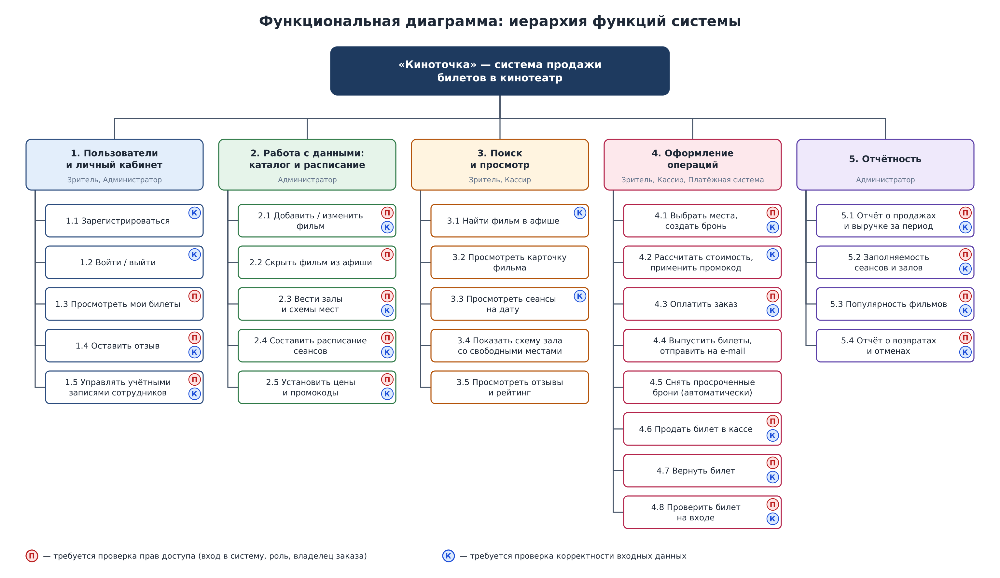
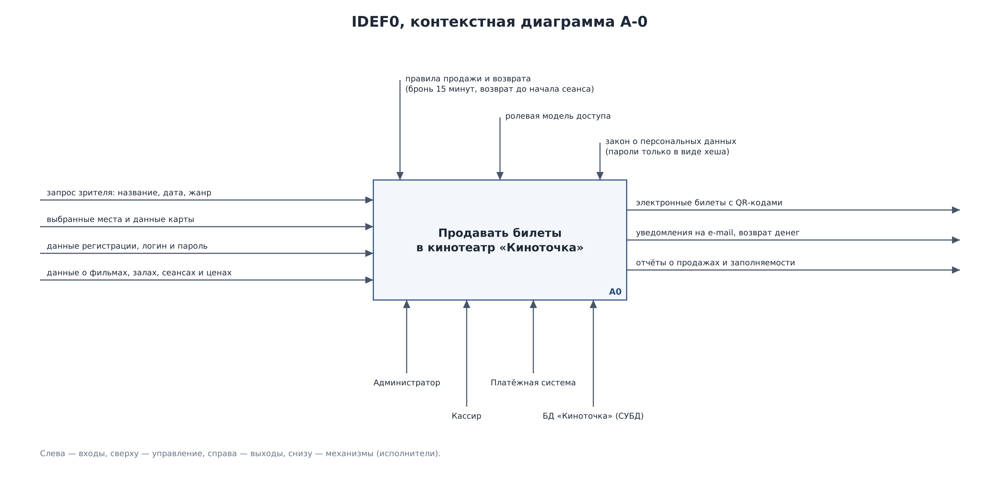
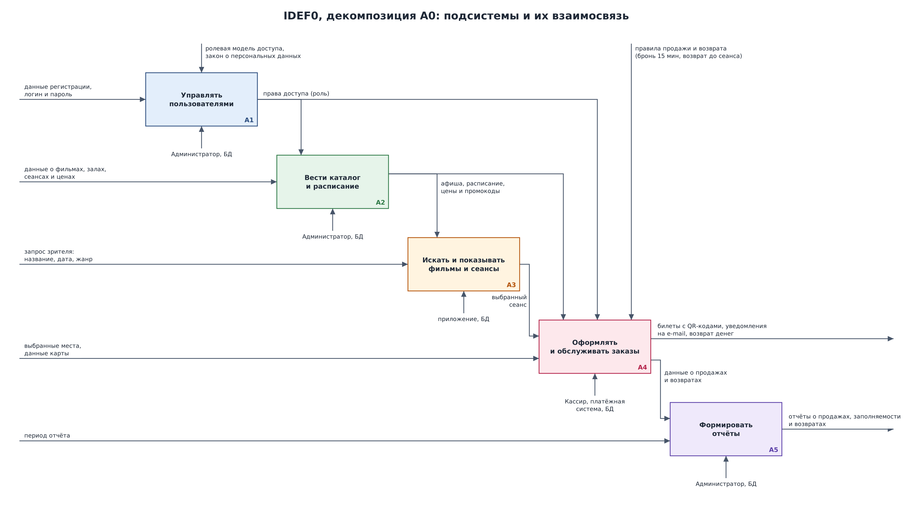

# День 3. Функциональная модель системы

**Предметная область:** кинотеатр «Киноточка», система онлайн-продажи билетов (продолжение [дней 1](../UML_Den1) и [2](../UML_Den2)).

## Задание 1. Перечень функций по группам

Функции системы разбиты на 5 групп (подсистем) по назначению — всего 27 функций.
Номер функции одинаковый на диаграммах и в таблице ниже.

| Группа | Кто работает | Функции |
|---|---|---|
| **1. Пользователи и личный кабинет** (управление пользователями) | Зритель, Администратор | 1.1 Зарегистрироваться · 1.2 Войти / выйти · 1.3 Просмотреть мои билеты · 1.4 Оставить отзыв · 1.5 Управлять учётными записями сотрудников |
| **2. Работа с данными: каталог и расписание** | Администратор | 2.1 Добавить / изменить фильм · 2.2 Скрыть фильм из афиши · 2.3 Вести залы и схемы мест · 2.4 Составить расписание сеансов · 2.5 Установить цены и промокоды |
| **3. Поиск и просмотр** | Зритель, Кассир | 3.1 Найти фильм в афише · 3.2 Просмотреть карточку фильма · 3.3 Просмотреть сеансы на дату · 3.4 Показать схему зала · 3.5 Просмотреть отзывы и рейтинг |
| **4. Оформление операций** | Зритель, Кассир, Платёжная система | 4.1 Выбрать места, создать бронь · 4.2 Рассчитать стоимость, применить промокод · 4.3 Оплатить заказ · 4.4 Выпустить билеты, отправить на e-mail · 4.5 Снять просроченные брони · 4.6 Продать билет в кассе · 4.7 Вернуть билет · 4.8 Проверить билет на входе |
| **5. Отчётность** | Администратор | 5.1 Отчёт о продажах и выручке · 5.2 Заполняемость сеансов и залов · 5.3 Популярность фильмов · 5.4 Отчёт о возвратах и отменах |

Функции взяты из вариантов использования дня 1 и методов классов дня 2. Добавлены три функции, которые
на прежних диаграммах не были выделены отдельно, но без них система не работает:
**1.5 Управлять учётными записями сотрудников** (кто-то должен заводить кассиров),
**2.3 Вести залы и схемы мест** (без них нельзя продать место) и
**4.5 Снять просроченные брони** (автоматический переход заказа «Забронирован → Отменён» с диаграммы состояний).

## Задание 2. Функциональная диаграмма

### Иерархия функций: общая функция → подсистемы → операции

Верхний уровень — общая функция системы, второй — 5 подсистем, третий — операции.
Значками отмечены функции, которым нужна проверка: **П** — прав доступа, **К** — корректности данных.

### Взаимосвязь функций в нотации IDEF0

Чтобы показать не только состав, но и связи функций, модель построена ещё и в нотации IDEF0.
У каждого блока: слева — **входы** (что обрабатывается), сверху — **управление** (правила и ограничения),
справа — **выходы** (результат), снизу — **механизмы** (кто или что выполняет).

**Контекстная диаграмма A-0** — система целиком как одна функция:

**Декомпозиция A0** — пять подсистем и потоки данных между ними:

Как связаны подсистемы:

- **A1 «Управлять пользователями»** выдаёт **права доступа (роль)**. Они управляют работой A2 (каталог меняет
  только администратор) и A4 (покупать может только вошедший зритель, продавать в кассе — кассир).
- **A2 «Вести каталог и расписание»** выдаёт **афишу, расписание, цены и промокоды** — по ним работают поиск (A3)
  и оформление заказов (A4).
- **A3 «Искать и показывать фильмы и сеансы»** передаёт в A4 **выбранный сеанс**.
- **A4 «Оформлять и обслуживать заказы»** работает по **правилам продажи и возврата** (бронь 15 минут,
  возврат до начала сеанса) и выдаёт зрителю **билеты с QR-кодами, уведомления и возврат денег**.
  Исполнители — кассир и платёжная система.
- **A4** передаёт **данные о продажах и возвратах** в **A5 «Формировать отчёты»**, а A5 выдаёт администратору отчёты.

## Задание 3. Входные и выходные данные функций

**П** — функция проверяет права доступа (вход в систему, роль, владелец заказа).
**К** — функция проверяет корректность входных данных.

<!-- TABLE -->
| № | Функция | Кто | Входные данные | Что изменяет | Результат | П | К | Комментарий |
|---|---|---|---|---|---|---|---|---|
| 1.1 | Зарегистрироваться | Зритель | ФИО, email, телефон, пароль, повтор пароля | Пользователи: новая запись с ролью ЗРИТЕЛЬ и хешем пароля | сообщение «Регистрация завершена», вход в аккаунт |  | ✔ | обязательные поля заполнены; email в верном формате и не занят; пароль не короче 6 символов и совпадает с повтором |
| 1.2 | Войти / выйти | все роли | email, пароль | — (открывается или закрывается сессия) | главная форма для своей роли или «Неверный email или пароль» |  | ✔ | хеш введённого пароля сравнивается с сохранённым; в ошибке не уточняется, что именно неверно |
| 1.3 | Просмотреть мои билеты | Зритель | пользователь из сессии | — | список заказов и билетов со статусами | ✔ |  | показываются только заказы текущего пользователя |
| 1.4 | Оставить отзыв | Зритель | фильм, оценка, текст | Отзывы: новая запись; меняется рейтинг фильма | отзыв в карточке фильма, новый рейтинг | ✔ | ✔ | только по заказу в статусе «Завершён», один отзыв на фильм; оценка от 1 до 5 |
| 1.5 | Управлять учётными записями сотрудников | Администратор | ФИО, email, роль; выбранная учётная запись | Пользователи: добавление, смена роли, блокировка | обновлённый список сотрудников | ✔ | ✔ | доступно только администратору; нельзя заблокировать самого себя |
| 2.1 | Добавить / изменить фильм | Администратор | название, жанр, длительность, возрастной рейтинг, описание, постер | Фильмы | карточка фильма в афише | ✔ | ✔ | название обязательно; длительность больше 0; рейтинг из списка 0+, 6+, 12+, 16+, 18+ |
| 2.2 | Скрыть фильм из афиши | Администратор | выбранный фильм | Фильмы: активен = false | фильм пропадает из поиска | ✔ |  | уже проданные билеты на будущие сеансы остаются действительными |
| 2.3 | Вести залы и схемы мест | Администратор | номер зала, число рядов, мест в ряду, типы мест | Залы, Места | схема зала | ✔ | ✔ | нельзя удалить зал или место, на которые есть билеты (ограничение внешнего ключа) |
| 2.4 | Составить расписание сеансов | Администратор | фильм, зал, дата и время, формат, базовая цена | Сеансы | сеанс в расписании | ✔ | ✔ | время в будущем; сеанс не пересекается с другими в этом зале с учётом длительности фильма |
| 2.5 | Установить цены и промокоды | Администратор | базовая цена сеанса, коэффициенты мест; код, скидка, срок промокода | Сеансы, Места, Промокоды | новые цены и активные промокоды | ✔ | ✔ | цена больше 0; скидка 1–100 %; код уникален; срок не в прошлом |
| 3.1 | Найти фильм в афише | все роли | часть названия, дата, жанр | — | список фильмов или «Ничего не найдено» |  | ✔ | дата не раньше сегодняшней; пустой запрос — вся афиша; запрос к БД только с параметрами |
| 3.2 | Просмотреть карточку фильма | все роли | выбранный фильм | — | описание, постер, рейтинг |  |  | скрытые фильмы не показываются |
| 3.3 | Просмотреть сеансы на дату | все роли | фильм, дата | — | список сеансов: время, зал, формат, цена |  | ✔ | показываются только сеансы, которые ещё не начались |
| 3.4 | Показать схему зала | все роли | выбранный сеанс | — | схема зала: свободные, занятые и заблокированные места |  |  | схема читается заново при каждом открытии |
| 3.5 | Просмотреть отзывы и рейтинг | все роли | выбранный фильм | — | список отзывов и средняя оценка |  |  | — |
| 4.1 | Выбрать места, создать бронь | Зритель | сеанс, выбранные места | Заказы (статус ЗАБРОНИРОВАН), Билеты; места блокируются | заказ и таймер брони на 15 минут | ✔ | ✔ | вход выполнен; места свободны (проверка в транзакции); не больше 10 мест; сеанс ещё не начался |
| 4.2 | Рассчитать стоимость, применить промокод | Зритель, Кассир | заказ, промокод (необязательно) | Заказы: сумма, скидка, итого | итоговая сумма к оплате |  | ✔ | промокод существует, активен и не истёк; цена места = базовая цена × коэффициент |
| 4.3 | Оплатить заказ | Зритель | заказ; данные карты уходят сразу в платёжную систему | Платежи: новая запись; заказ ОПЛАЧИВАЕТСЯ → ОПЛАЧЕН | «Оплата прошла» или «Платёж отклонён» | ✔ | ✔ | заказ принадлежит пользователю; бронь не истекла; данные карты в системе не хранятся |
| 4.4 | Выпустить билеты, отправить на e-mail | система | оплаченный заказ | Билеты: QR-коды | электронные билеты в письме и в «Моих билетах» |  |  | QR-код уникален |
| 4.5 | Снять просроченные брони | система (по таймеру) | текущее время | Заказы → ОТМЕНЁН; места освобождаются | места снова свободны для других зрителей |  |  | выполняется автоматически раз в минуту |
| 4.6 | Продать билет в кассе | Кассир | сеанс, места, способ оплаты | Заказы (сразу ОПЛАЧЕН), Билеты, Платежи | напечатанный билет | ✔ | ✔ | роль КАССИР; те же проверки мест, что и в 4.1 |
| 4.7 | Вернуть билет | Зритель, Кассир | заказ | Заказы → ВОЗВРАЩЁН; Платежи: возврат; места освобождаются | «Деньги вернутся на карту» | ✔ | ✔ | заказ свой (или действует кассир); статус ОПЛАЧЕН; сеанс ещё не начался |
| 4.8 | Проверить билет на входе | Кассир | QR-код билета | Билеты: использован = true | «Проход разрешён» или причина отказа | ✔ | ✔ | билет существует и не использован; заказ оплачен; сеанс сегодня и в этом зале |
| 5.1 | Отчёт о продажах и выручке за период | Администратор | период: с, по | — | таблица по дням: продано билетов, выручка, сумма скидок | ✔ | ✔ | дата «с» не позже даты «по»; период не больше года |
| 5.2 | Заполняемость сеансов и залов | Администратор | период, зал (необязательно) | — | процент занятых мест по сеансам и залам | ✔ | ✔ | проверка периода, как в 5.1 |
| 5.3 | Популярность фильмов | Администратор | период | — | фильмы по числу проданных билетов и средней оценке | ✔ | ✔ | проверка периода, как в 5.1 |
| 5.4 | Отчёт о возвратах и отменах | Администратор | период | — | число и сумма возвратов, число просроченных броней | ✔ | ✔ | проверка периода, как в 5.1 |
<!-- /TABLE -->

**Итог:** из 27 функций проверку прав требуют 17, проверку данных — 20, обе проверки — 15.
Без проверок только 5 функций: просмотр карточки, схемы зала и отзывов (данные открыты всем и ничего не меняют)
и две автоматические функции системы (4.4, 4.5), которые запускаются уже после проверок.

Общие правила для всех функций:

- запросы к базе данных строятся только с параметрами — пользовательский ввод не склеивается с текстом SQL;
- пароли хранятся только в виде хеша, данные банковских карт в системе не хранятся;
- при ошибке пользователь видит понятное сообщение без технических подробностей.

Таблица в формате Excel — файл `functions.csv`.

## Файлы

| Файл | Что это |
|---|---|
| `hierarchy.drawio`, `idef0_context.drawio`, `idef0_a0.drawio` | **редактируемые** диаграммы — открыть на [app.diagrams.net](https://app.diagrams.net) или в draw.io Desktop |
| `hierarchy.png`, `idef0_context.png`, `idef0_a0.png` | экспорт в PNG |
| `*.pdf`, `*.svg` | экспорт в PDF и SVG (векторные) |
| `functions.csv` | таблица функций с входными данными, результатами и комментариями (открывается в Excel) |
| `Отчёт_День3.pdf` | готовый отчёт: перечень функций, диаграммы, таблица |
| `tools/` | скрипты, которыми сделаны диаграммы и таблица (`pip install cairosvg`, затем `python tools/build_diagrams.py` и `python tools/functions_table.py`) |
