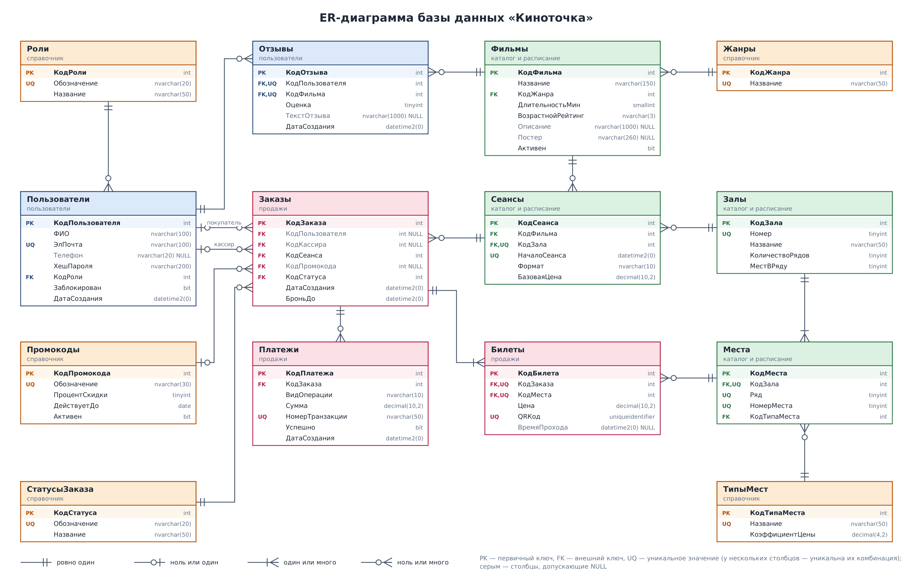

# День 4. Проектирование и создание базы данных

**Предметная область:** кинотеатр «Киноточка», система онлайн-продажи билетов (продолжение дней [1](../UML_Den1), [2](../UML_Den2), [3](../UML_Den3)).
**СУБД:** Microsoft SQL Server (подходит SQL Server 2016 и новее, в том числе LocalDB из Visual Studio — на ней будет приложение дней 5–6).

**Как создать базу:** открыть в SQL Server Management Studio по очереди и выполнить (F5):

1. `sql/01_create.sql` — база `Киноточка`, 14 таблиц, ключи и ограничения, индексы, триггер, представление;
2. `sql/02_data.sql` — тестовые данные;
3. `sql/03_queries.sql` — примеры запросов и проверки целостности.

Все три скрипта проверены на SQL Server 2022: выполняются без ошибок, в том числе при повторном запуске
(база пересоздаётся). Результаты запросов ниже — настоящий вывод сервера.

**Именование.** Все объекты базы названы по-русски в стиле CamelCase без пробелов, поэтому их не нужно брать в квадратные скобки:
таблицы — существительное во множественном числе (`Фильмы`, `Заказы`), первичный ключ — `Код` + сущность в родительном падеже
(`КодФильма`), внешний ключ называется так же, как первичный ключ, на который ссылается (исключение — `КодКассира`,
второй ключ на `Пользователи`). Ограничения: `PK_Таблица`, `FK_Таблица_Таблица`, `UQ_Таблица_Столбец`, `CK_Таблица_Столбец`,
`DF_Таблица_Столбец`, индексы — `IX_Таблица_Столбец`. Коды ролей, статусов и видов платежа тоже русские
(`ЗРИТЕЛЬ`, `ОПЛАЧЕН`, `ВОЗВРАТ`).

## Задание 1. ER-диаграмма

Сущности и их атрибуты выгружены из созданной базы (`tools/schema.json`), поэтому диаграмма совпадает со скриптом.
Цвет заголовка — группа таблиц: оранжевый — справочники, зелёный — каталог и расписание,
синий — пользователи, розовый — продажи.

### Связи

| Родительская таблица | Дочерняя таблица | Внешний ключ | Кратность | Смысл |
|---|---|---|---|---|
| Роли | Пользователи | `Пользователи.КодРоли` | 1 : 0..\* | у пользователя одна роль |
| Пользователи | Заказы | `Заказы.КодПользователя` (NULL) | 0..1 : 0..\* | покупатель; пусто при продаже в кассе без аккаунта |
| Пользователи | Заказы | `Заказы.КодКассира` (NULL) | 0..1 : 0..\* | кассир, оформивший продажу; пусто при покупке на сайте |
| Пользователи | Отзывы | `Отзывы.КодПользователя` | 1 : 0..\* | автор отзыва |
| Жанры | Фильмы | `Фильмы.КодЖанра` | 1 : 0..\* | жанр фильма |
| Фильмы | Сеансы | `Сеансы.КодФильма` | 1 : 0..\* | что показывают на сеансе |
| Фильмы | Отзывы | `Отзывы.КодФильма` | 1 : 0..\* | о каком фильме отзыв |
| Залы | Сеансы | `Сеансы.КодЗала` | 1 : 0..\* | где идёт сеанс |
| Залы | Места | `Места.КодЗала` | 1 : 1..\* | места зала |
| ТипыМест | Места | `Места.КодТипаМеста` | 1 : 0..\* | тип места и наценка |
| Сеансы | Заказы | `Заказы.КодСеанса` | 1 : 0..\* | заказ на один сеанс |
| Промокоды | Заказы | `Заказы.КодПромокода` (NULL) | 0..1 : 0..\* | применённый промокод |
| СтатусыЗаказа | Заказы | `Заказы.КодСтатуса` | 1 : 0..\* | текущий статус заказа |
| Заказы | Билеты | `Билеты.КодЗаказа`, `ON DELETE CASCADE` | 1 : 1..\* | билеты заказа (композиция) |
| Места | Билеты | `Билеты.КодМеста` | 1 : 0..\* | место билета |
| Заказы | Платежи | `Платежи.КодЗаказа` | 1 : 0..\* | оплаты и возвраты по заказу |

Связь «многие ко многим» между заказом и местом раскрыта через таблицу **Билеты**.

### Соответствие диаграмме классов (день 2)

| Класс | Таблица | Что изменилось |
|---|---|---|
| Пользователь, перечисление Роль | Пользователи, Роли | роль — справочник с внешним ключом |
| Фильм | Фильмы, Жанры | жанр вынесен в справочник |
| Зал | Залы | — |
| Место | Места, ТипыМест | тип места и коэффициент цены вынесены в справочник |
| Сеанс | Сеансы | — |
| Заказ, перечисление СтатусЗаказа | Заказы, СтатусыЗаказа | сумма, скидка и итог не хранятся, а считаются в представлении `СуммыЗаказов` |
| Билет | Билеты | `ВремяПрохода` вместо флага «использован» — заодно хранит время прохода |
| Платёж | Платежи | — |
| Промокод | Промокоды | — |
| Отзыв | Отзывы | — |

## Задание 2. Структура базы данных

14 взаимосвязанных таблиц (требуется минимум 8). Полный список столбцов и типов — на ER-диаграмме и в `sql/01_create.sql`.

| Таблица | Назначение | PK | Внешние ключи | UNIQUE | CHECK и другие ограничения |
|---|---|---|---|---|---|
| Роли | роли пользователей | КодРоли | — | Обозначение | — |
| Пользователи | учётные записи | КодПользователя | КодРоли | ЭлПочта | формат email; `Заблокирован` по умолчанию 0 |
| Жанры | жанры | КодЖанра | — | Название | — |
| Фильмы | фильмы | КодФильма | КодЖанра | — | длительность 1–600 мин; рейтинг из 0+, 6+, 12+, 16+, 18+ |
| Залы | залы | КодЗала | — | Номер | рядов и мест в ряду больше 0 |
| ТипыМест | типы мест | КодТипаМеста | — | Название | коэффициент цены больше 0 |
| Места | места залов | КодМеста | КодЗала, КодТипаМеста | (КодЗала, Ряд, НомерМеста) | ряд и номер больше 0 |
| Сеансы | сеансы | КодСеанса | КодФильма, КодЗала | (КодЗала, НачалоСеанса) | формат 2D / 3D / IMAX; цена больше 0 |
| Промокоды | промокоды | КодПромокода | — | Обозначение | скидка 1–100 % |
| СтатусыЗаказа | статусы заказа | КодСтатуса | — | Обозначение | — |
| Заказы | заказы | КодЗаказа | КодПользователя, КодКассира, КодСеанса, КодПромокода, КодСтатуса | — | заполнен покупатель или кассир; `БроньДо` позже `ДатаСоздания` |
| Билеты | билеты | КодБилета | КодЗаказа (каскадное удаление), КодМеста | QRКод; (КодЗаказа, КодМеста) | цена не отрицательная; **триггер**: место из зала сеанса и не продано дважды |
| Платежи | оплаты и возвраты | КодПлатежа | КодЗаказа | НомерТранзакции | вид ОПЛАТА / ВОЗВРАТ; сумма больше 0 |
| Отзывы | отзывы | КодОтзыва | КодПользователя, КодФильма | (КодПользователя, КодФильма) | оценка 1–5 |

**NOT NULL** стоит у всех столбцов, кроме тех, где значение действительно может отсутствовать:
телефон пользователя, описание и постер фильма, текст отзыва, время прохода по билету (`ВремяПрохода` пуст,
пока билет не отсканирован), а также покупатель, кассир и промокод заказа.

**Типы данных:** `NVARCHAR` — для текста на русском; `DECIMAL(10,2)` — для денег (без ошибок округления, как у `FLOAT`);
`DATETIME2(0)` — дата и время с точностью до секунды; `TINYINT` / `SMALLINT` — для небольших чисел (ряд, место, длительность);
`UNIQUEIDENTIFIER` — для QR-кода билета (его нельзя подобрать); `BIT` — для флагов.

**Пароли** хранятся только как хеш PBKDF2-SHA256 (100 000 итераций, своя соль у каждого пользователя)
в формате `PBKDF2$итерации$соль$хеш`. Тестовый пароль всех учётных записей — `123456`.

## Задание 3. Нормализация до 3НФ

**1НФ** — все значения атомарны, повторяющихся групп нет. Например, места заказа хранятся не списком в строке
заказа («5-7, 5-8»), а отдельными строками таблицы Билеты; места зала — строками таблицы Места, а не столбцами «ряд 1», «ряд 2».

**2НФ** — в таблицах с одиночным суррогатным ключом (`Код…`) неполных зависимостей быть не может. Составные
уникальные ключи — (КодЗала, Ряд, НомерМеста) в таблице Места, (КодЗаказа, КодМеста) в Билеты, (КодПользователя, КодФильма) в Отзывы —
проверены: остальные столбцы зависят от всего набора, а не от его части. Например, тип места зависит от зала,
ряда и номера вместе, а не от одного только номера ряда.

**3НФ** — неключевые столбцы не зависят друг от друга. Что для этого сделано:

| Было бы с нарушением | Транзитивная зависимость | Решение |
|---|---|---|
| `Фильмы.Жанр` — название жанра текстом | название повторяется у многих фильмов, опечатка даёт «новый» жанр | справочник **Жанры**, в таблице Фильмы — `КодЖанра` |
| `Места.КоэффициентЦены` рядом с `Места.ТипМеста` | КодМеста → тип → коэффициент | справочник **ТипыМест** с коэффициентом |
| `Пользователи.НазваниеРоли`, `Заказы.НазваниеСтатуса` | код → обозначение → название | справочники **Роли** и **СтатусыЗаказа** |
| `Заказы.Итого`, `Заказы.Скидка` | итог = сумма цен билетов × (100 − скидка промокода) / 100 | не хранятся; считаются в представлении **СуммыЗаказов** |
| `Билеты.КодСеанса` для проверки двойной продажи | КодБилета → КодЗаказа → КодСеанса | не дублируется; правило «одно место — один билет на сеанс» проверяет **триггер** `ТР_Билеты_ПроверкаМеста` |
| `Сеансы.НазваниеФильма`, `Сеансы.НазваниеЗала` | КодСеанса → КодФильма → название | в таблице Сеансы только внешние ключи |

Сознательно хранимые значения, которые 3НФ не нарушают:

- `Билеты.Цена` — цена на момент продажи. От текущей цены сеанса она не зависит функционально: после изменения
  цен старые билеты должны остаться с той суммой, которую за них заплатили.
- `Платежи.Сумма` — сумма, которую подтвердил банк; это факт операции, а не вычисляемое значение.

## Задание 4. Заполнение и проверка

### Тестовые данные

| Таблица | Записей | | Таблица | Записей |
|---|---|---|---|---|
| Роли | 3 \* | | Сеансы | 12 |
| Пользователи | 8 | | Промокоды | 5 |
| Жанры | 6 | | СтатусыЗаказа | 6 \* |
| Фильмы | 7 | | Заказы | 12 |
| Залы | 5 | | Билеты | 24 |
| ТипыМест | 5 | | Платежи | 12 |
| Места | 346 | | Отзывы | 6 |

\* В справочниках ролей и статусов ровно столько записей, сколько значений в предметной области
(3 роли и 6 состояний заказа с диаграммы состояний дня 2) — добавлять несуществующие роли и статусы нельзя.
Места (346) генерируются по размерам залов одним запросом.

В данных есть заказы во всех шести статусах, продажа в кассе без аккаунта, неудачная и повторная оплата,
возврат денег, промокоды и заблокированный пользователь — чтобы на них можно было проверить запросы и приложение.

### Проверка внешних ключей

<!-- R10 -->
| ВнешнихКлючей | Отключённых |
|---|---|
| 16 | 0 |
<!-- /R10 -->

`DBCC CHECKCONSTRAINTS WITH ALL_CONSTRAINTS` не нашла нарушений ни одного ограничения.

<!-- R11 -->
| Связь | БезРодителя |
|---|---|
| Билеты → Заказы | 0 |
| Билеты → Места | 0 |
| Заказы → Сеансы | 0 |
| Платежи → Заказы | 0 |
<!-- /R11 -->

Ошибочные данные база не принимает — каждая попытка выполнялась в транзакции с откатом:

<!-- R12 -->
| Проверка | Результат |
|---|---|
| Билет на несуществующий заказ | отклонено (547): внешний ключ |
| Второй пользователь с тем же email | отклонено (2627): UNIQUE |
| Отзыв с оценкой 7 | отклонено (547): CHECK |
| Повторная продажа занятого места | отклонено (50002): Это место на сеанс уже продано или забронировано. |
| Покупка места из отменённого заказа | принято — место свободно |
| Билет на место из другого зала | отклонено (50001): Место находится в другом зале, не в зале сеанса. |
| Удаление фильма, у которого есть сеансы | отклонено (547): внешний ключ |
<!-- /R12 -->

### Примеры SELECT-запросов

Все запросы — в `sql/03_queries.sql`; значения, которые вводит пользователь, вынесены в параметры `@…`.

**1. Афиша на 21.11.2026** — соединение 4 таблиц, фильтр по дате, сортировка по времени, подсчёт свободных мест:

<!-- R1 -->
| Начало | Фильм | Жанр | Возраст | Зал | Формат | Цена | СвободноМест |
|---|---|---|---|---|---|---|---|
| 10:00 | Кот в библиотеке | Мультфильм | 0+ | Комфорт | 2D | 300.00 | 60 |
| 18:00 | Звёздный маршрут | Фантастика | 12+ | IMAX | IMAX | 650.00 | 120 |
| 19:30 | Свадьба по ошибке | Комедия | 12+ | Малый | 2D | 380.00 | 39 |
| 21:00 | Звёздный маршрут | Фантастика | 12+ | Большой | 3D | 500.00 | 94 |
| 22:00 | Ночной звонок | Триллер | 18+ | VIP | 2D | 600.00 | 24 |
<!-- /R1 -->

**2. Поиск фильма по части названия «ноч»** — `LIKE` с параметром:

<!-- R2 -->
| Фильм | Жанр | Минут | Возраст |
|---|---|---|---|
| Ночной звонок | Триллер | 104 | 18+ |
<!-- /R2 -->

**3. Свободные места на сеанс 5 по рядам с ценой по типу места** — `LEFT JOIN … IS NULL`, `GROUP BY`, `STRING_AGG`:

<!-- R3 -->
| Ряд | ТипМеста | Цена | Свободно | Места |
|---|---|---|---|---|
| 1 | Для маломобильных зрителей | 350.00 | 2 | 1, 12 |
| 1 | Стандарт | 500.00 | 10 | 2, 3, 4, 5, 6, 7, 8, 9, 10, 11 |
| 2 | Стандарт | 500.00 | 12 | 1, 2, 3, 4, 5, 6, 7, 8, 9, 10, 11, 12 |
| 3 | Стандарт | 500.00 | 12 | 1, 2, 3, 4, 5, 6, 7, 8, 9, 10, 11, 12 |
| 4 | Комфорт | 600.00 | 12 | 1, 2, 3, 4, 5, 6, 7, 8, 9, 10, 11, 12 |
| 5 | Комфорт | 600.00 | 12 | 1, 2, 3, 4, 5, 6, 7, 8, 9, 10, 11, 12 |
| 6 | Стандарт | 500.00 | 12 | 1, 2, 3, 4, 5, 6, 7, 8, 9, 10, 11, 12 |
| 7 | Стандарт | 500.00 | 12 | 1, 2, 3, 4, 5, 6, 7, 8, 9, 10, 11, 12 |
| 8 | Диван | 900.00 | 10 | 1, 2, 3, 4, 7, 8, 9, 10, 11, 12 |
<!-- /R3 -->

**4. «Мои билеты» зрителя Иванова** — соединение 7 таблиц, сортировка по дате сеанса:

<!-- R4 -->
| Заказ | Фильм | Сеанс | Зал | Ряд | Место | Цена | Статус |
|---|---|---|---|---|---|---|---|
| 10 | Свадьба по ошибке | 21.11.2026 19:30 | Малый | 3 | 4 | 456.00 | Оплачивается |
| 5 | Звёздный маршрут | 21.11.2026 18:00 | IMAX | 5 | 7 | 780.00 | Оплачен |
| 5 | Звёздный маршрут | 21.11.2026 18:00 | IMAX | 5 | 8 | 780.00 | Оплачен |
| 1 | Звёздный маршрут | 12.11.2026 19:00 | Большой | 5 | 6 | 540.00 | Завершён |
| 1 | Звёздный маршрут | 12.11.2026 19:00 | Большой | 5 | 7 | 540.00 | Завершён |
<!-- /R4 -->

**5. Суммы заказов через представление `СуммыЗаказов`** — `LEFT JOIN` для продаж в кассе и заказов без промокода:

<!-- R5 -->
| Заказ | Покупатель | Статус | Билетов | Сумма | Скидка | Итого | Промокод |
|---|---|---|---|---|---|---|---|
| 11 | (продажа в кассе) | Оплачен | 4 | 2600.00 | 0.00 | 2600.00 | — |
| 7 | Петрова Анна Викторовна | Возвращён | 2 | 1920.00 | 0.00 | 1920.00 | — |
| 6 | Козлова Екатерина Дмитриевна | Оплачен | 2 | 1800.00 | 0.00 | 1800.00 | — |
| 5 | Иванов Иван Иванович | Оплачен | 2 | 1560.00 | 156.00 | 1404.00 | FIRST10 |
| 1 | Иванов Иван Иванович | Завершён | 2 | 1080.00 | 0.00 | 1080.00 | — |
| 3 | (продажа в кассе) | Завершён | 3 | 1080.00 | 0.00 | 1080.00 | — |
| 9 | Козлова Екатерина Дмитриевна | Забронирован | 2 | 1008.00 | 0.00 | 1008.00 | — |
| 4 | Сидоров Павел Олегович | Завершён | 2 | 960.00 | 0.00 | 960.00 | — |
| 12 | Морозов Дмитрий Алексеевич | Оплачен | 2 | 900.00 | 450.00 | 450.00 | BIRTHDAY50 |
| 8 | Сидоров Павел Олегович | Отменён | 1 | 360.00 | 0.00 | 360.00 | — |
| 2 | Петрова Анна Викторовна | Завершён | 1 | 450.00 | 90.00 | 360.00 | STUDENT20 |
| 10 | Иванов Иван Иванович | Оплачивается | 1 | 456.00 | 114.00 | 342.00 | NEWYEAR25 |
<!-- /R5 -->

**6. Выручка по фильмам за ноябрь** — `SUM` с учётом возвратов, сортировка по выручке:

<!-- R6 -->
| Фильм | Оплачено | Возвращено | Выручка |
|---|---|---|---|
| Звёздный маршрут | 7244.00 | 0.00 | 7244.00 |
| Кот в библиотеке | 1080.00 | 0.00 | 1080.00 |
| Последний трамвай | 960.00 | 0.00 | 960.00 |
| Свадьба по ошибке | 450.00 | 0.00 | 450.00 |
| Ночной звонок | 1920.00 | 1920.00 | 0.00 |
<!-- /R6 -->

**7. Заполняемость сеансов** — доля проданных мест от вместимости зала:

<!-- R7 -->
| Сеанс | Фильм | Зал | Продано | Мест | Процент |
|---|---|---|---|---|---|
| 14.11 11:00 | Кот в библиотеке | Комфорт | 3 | 60 | 5.0 |
| 15.11 20:30 | Последний трамвай | Малый | 2 | 40 | 5.0 |
| 21.11 18:00 | Звёздный маршрут | IMAX | 6 | 126 | 4.8 |
| 12.11 19:00 | Звёздный маршрут | Большой | 3 | 96 | 3.1 |
| 21.11 21:00 | Звёздный маршрут | Большой | 2 | 96 | 2.1 |
| 23.11 20:00 | Свадьба по ошибке | IMAX | 2 | 126 | 1.6 |
<!-- /R7 -->

**8. Рейтинг фильмов** — `AVG` и `HAVING` (только фильмы с двумя и более отзывами):

<!-- R8 -->
| Фильм | Отзывов | СредняяОценка |
|---|---|---|
| Кот в библиотеке | 2 | 4.50 |
| Звёздный маршрут | 3 | 4.00 |
<!-- /R8 -->

**9. Просроченные брони** (функция 4.5 «Снять просроченные брони» из дня 3):

<!-- R9 -->
| Заказ | Зритель | БроньДо | ПросроченоМинут |
|---|---|---|---|
| 9 | kozlova@example.com | 2026-11-19 10:05:00 | 25 |
<!-- /R9 -->

## Файлы

| Файл | Что это |
|---|---|
| `sql/01_create.sql` | скрипт создания базы: таблицы, ключи, ограничения, индексы, триггер, представление |
| `sql/02_data.sql` | тестовые данные |
| `sql/03_queries.sql` | примеры SELECT-запросов и проверки целостности |
| `er.drawio` | **редактируемая** ER-диаграмма — открыть на [app.diagrams.net](https://app.diagrams.net) или в draw.io Desktop |
| `er.png`, `er.pdf`, `er.svg` | экспорт ER-диаграммы |
| `Отчёт_День4.pdf` | готовый отчёт: диаграмма, структура, нормализация, данные и запросы с результатами |
| `tools/` | генератор ER-диаграммы и выгрузка структуры базы (`schema.json`) |
